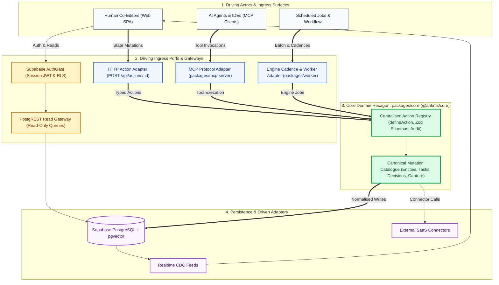

# ahOS Starter

> [!NOTE]
> Provided as-is as an architecture & engineering reference; not actively maintained; downstream snapshot of a private personal repository.

`ahOS` is a TypeScript monorepo implementing an agent-native personal operating system and knowledge management backend. It is built as a **tooling and domain layer, not an autonomous agent**: domain logic, typed actions, and persistence live in a central kernel, while external AI clients and human co-editors interact through strictly typed protocol adapters.

## Monorepo Overview

Orchestrated with npm workspaces and Turborepo:

| Path | Package / Role | Description |
| :--- | :--- | :--- |
| `packages/core` | `@ahkms/core` | Canonical domain kernel: Zod schemas, `defineAction` Centralised Action Registry (CAR), engine cadences, and driven adapters. |
| `packages/mcp-server` | `@ahkms/mcp-server` | Model Context Protocol (MCP) server and HTTP action gateway (`/api/actions`), exposing core actions to AI clients and the web app. |
| `packages/worker` | `@ahkms/worker` | Node/Express background worker handling document processing, ingestion, and workflow orchestration. |
| `packages/web` | `@ahkms/web` | Authenticated co-editing workspace and interactive Knowledge Graph canvas (Vite, React 19, Tailwind CSS). |
| `packages/shared` | `@ahkms/shared` | Cross-package TypeScript types shared across workspaces. |
| `supabase/migrations` | Database schema | PostgreSQL + `pgvector` schema migrations, RLS policies, and database functions. |
| `docs/architecture/` | Architecture docs | Runtime topology and current-state system documentation. |
| `docs/ADRs/` | Decision records | Architecture Decision Records explaining key design trade-offs and constraints. |
| `scripts/check-*` | CI guards | Zero-database static analysis and architectural invariant checks run locally and in CI. |

## Architecture

The system follows a **Hexagonal Architecture (Ports and Adapters)**. Every state mutation routes through the Centralised Action Registry in `@ahkms/core`, guaranteeing parity between human co-editors and AI agents. Low-latency UI reads go through Supabase PostgREST under Row-Level Security (RLS).



## Key Engineering Patterns

### 1. Unified `defineAction` Surface Parity

All domain mutations are declared once in `packages/core` via `defineAction`, with Zod input/output schemas and explicit surface exposure metadata.

- **Default-on surfaces:** Every action is enabled by default on `mcp`, `http`, `ui_agent`, and `worker` (while `cli` and `a2a` remain opt-in).
- **Closed-list opt-outs:** Turning off any default-on surface requires a closed-list `expose.reason` (`client_local`, `owner_only`, `app_internal`, `legacy_twin`, or `owner_decision_pending`) plus a non-empty `expose.note`.
- **Automated parity enforcement:** `npm run gen:action-manifest -w @ahkms/core` emits `@ahkms/core/action-manifest.json`. Contract tests verify that MCP tools, HTTP routes, web client actions, and worker job enqueues stay strictly aligned with the manifest, and that any legacy baseline list may only shrink.

### 2. Automated CI Architectural Guards (`scripts/check-*`)

Architectural boundaries are enforced as fast, zero-database scripts in `scripts/check-*` (orchestrated by `scripts/guards.js`):

- **Package boundaries and imports:** `check-core-isomorphic.js` (keeps browser-safe core exports free of Node built-ins), `check-core-import-direction.js` (enforces unidirectional dependency flow), `check-circular-deps.js`, `check-undeclared-deps.js`, `check-type-duplicates.js`, and `check-esm-smoke.js`.
- **Database migration safety:** `check-migration-signatures.js`, `check-migration-versions.js`, `check-migration-comments.js`, and `check-migration-collisions.js`.
- **Architecture and documentation hygiene:** `check-architecture-drift.js`, `check-adr-citations.js`, `check-adr-links.js`, `check-adr-numbers.js`, and `check-turbo-inputs.js`.
- **Runtime and security invariants:** `check-user-id-reads.js`, `check-client-writes.js`, `check-silent-fallback.js`, and `check-standalone-lockfiles.js`.

## Local Setup & Verification

### Prerequisites

- Node.js `>= 20.0.0`
- npm `11.x`

### Install and Typecheck

```bash
npm install
npm run typecheck
```

### Build and Unit Tests

```bash
npm run build
npm run test:unit
```

Running the full runtime stack locally requires a Supabase project and provider credentials supplied via `.env` files (not included in this snapshot).

## License

This repository is licensed under the MIT License. See [LICENSE](./LICENSE) for the full text.
