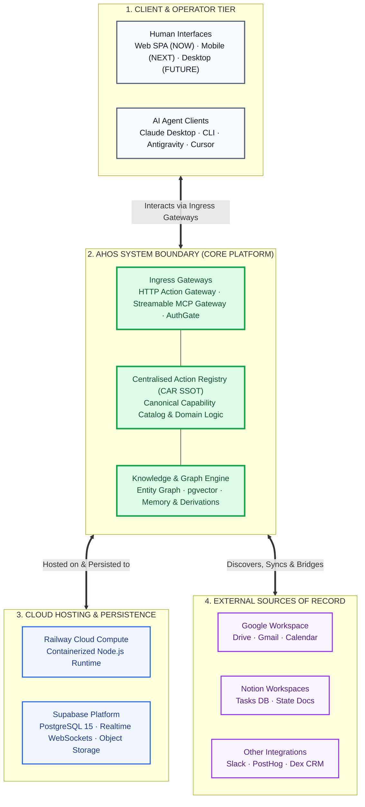
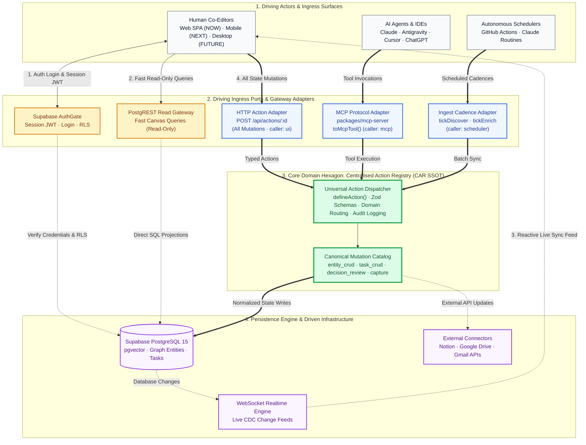
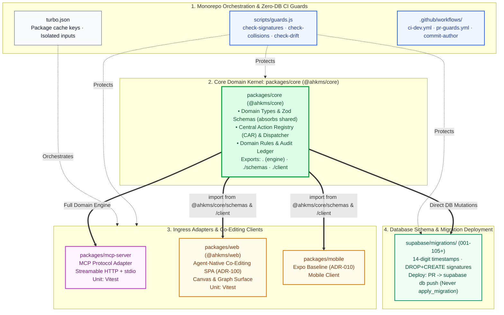
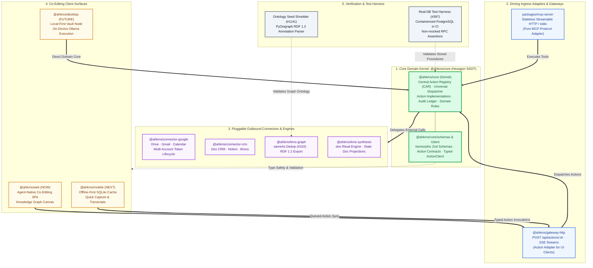
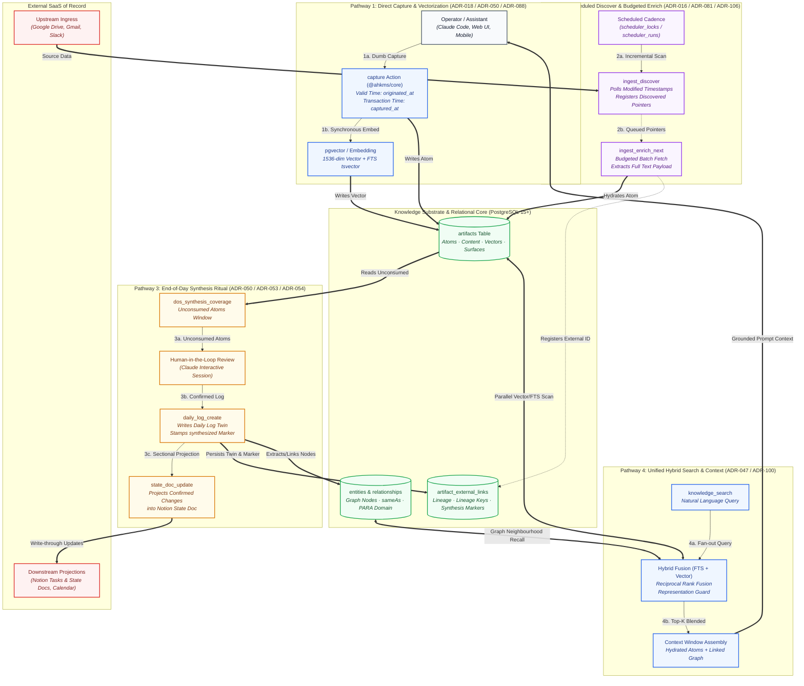

# Repository Architecture

**Reviewed-against:** ADR-115 · 2026-10-30 · evidence: scoped pass against ADR-105..115 (one core action registry and action-level exposure flags under [ADR-105](../ADRs/ADR105_One_Action_Registry_In_Core_With_Exposure_On_The_Action.md), metrics on `artifacts` at `role = 'metrics'` and State Doc hop-2 human review gate under [ADR-110](../ADRs/ADR110_Metrics_Ride_Artifacts_And_State_Doc_Is_The_Human_Review_Gate.md), Google Drive as single live home for PARA and ahOS outputs under [ADR-111](../ADRs/ADR111_Google_Drive_Is_The_Single_Live_Home_For_PARA_And_ahOS_Outputs.md), three ritual verbs `prep`/`sync`/`reflect` and task-anchored reconciliation under [ADR-112](../ADRs/ADR112_Three_Ritual_Verbs_Prep_Sync_Reflect_And_Task_Anchored_Reconciliation.md), `work-mcp` mapped L3 surface and `ahOS`-first personal-account SaaS precedence under [ADR-113](../ADRs/ADR113_Work_MCP_Is_A_Mapped_L3_Surface_Personal_Account_SaaS_Is_ahOS_First.md), five-layer Clean State contract via `clean_state_check` under [ADR-114](../ADRs/ADR114_Five_Layer_Clean_State_Contract.md), and 5-layer Recommended Capability Anatomy disambiguation under [ADR-115](../ADRs/ADR115_Recommended_Capability_Anatomy.md))

> Freshness here is enforced by the three mechanisms ADR-056 kept (its fourth, the per-ADR declaration block, was closed `wontfix` and narrowed by ADR-059 §7): the same-PR sync rule of ADR-039 §2, the apex-citation guard, and this watermark. None of them proves the document correct — they convert silent omission into a visible claim with a name on it, and the sync rule in particular has no enforcement at all, so nothing fails a PR that changes this document's shape and leaves it untouched.
>
> **The number itself used to under-report, and no longer does.** An ADR merged still reading `Proposed` was filtered out *before* the gap was measured, so it sat in neither the gap nor the blind-spot list — a defect in the instrument rather than in the record, which is worse, because a stale number you can see is one you act on. This document once read 4 behind when it was 5, for exactly that reason. [ADR-071](../ADRs/ADR071_Guards_Run_Locally_By_Default_CI_Is_The_Backstop.md) §4 fixed it: unstamped ADRs are now **counted and named** rather than dropped, kept out of `adrsBehind` because an undated ADR genuinely cannot be placed in the order. Widening the parser for it surfaced three older ADRs (006, 008, 009) whose `## Status` heading had never parsed at all, so the stated blind spot got larger by getting honest, and [ADR-073](../ADRs/ADR073_The_Pre_Rule_Corpus_Is_Backfilled_From_Its_Own_Dates.md) then backfilled the datable ones, leaving three.
>
> **Where these run has also changed.** ADR-065 made stamping CI's job; [ADR-071](../ADRs/ADR071_Guards_Run_Locally_By_Default_CI_Is_The_Backstop.md) established that anything depending on Actions is a thing that does not run, and [ADR-072](../ADRs/ADR072_The_Post_Merge_Hook_Stamps_And_Commits.md) moved the stamper into a `post-merge` hook that writes the commit on `git pull` of `dev`. `scripts/guards.js` runs the guards locally and CI is the backstop, not the other way round.

## Purpose
This document is the repo-wide runtime architecture reference for how `packages/core`, `packages/worker`, `packages/mcp-server`, `packages/web`, `packages/mobile`, and Supabase work together in production and local development (with `packages/core` established as the canonical domain kernel and `packages/web` unarchived under [ADR-100](../ADRs/ADR100_Unified_Action_Wrapper_And_Co_Editing_Surface.md) as the authenticated agent-native co-editing and graph workspace). It is the as-built "what the system is now" doc: one of the four lanes [ADR-075](../ADRs/ADR075_Four_Lanes_And_An_Undecided_Question_Is_An_Issue.md) names, and the only one that holds current state (see `docs/README.md`); the *why* behind each shape lives in the cited ADRs, and a question not yet decided is a `needs-grill` issue rather than anything here. Per ADR-039 §2, any ADR that changes this shape updates this document in the same PR.

**What is deliberately not in the stack** (ADR-029): LangChain, LangSmith and the Claude Agent SDK are all rejected. This repo is a **tooling layer, not an agent** — it has no autonomous loop and makes no LLM calls of its own beyond direct embedding-generation calls. Intelligence is supplied by the MCP client calling these tools. Observability is PostHog, already integrated, rather than a second vendor. Reach for an in-repo orchestration framework here and you are contradicting an accepted decision, not filling a gap.

## Production Topology

The system topology is organized across descending levels of abstraction, maintaining clear distinction between the **as-built current state** and the **target evolution roadmap**:
- **View 0 (System Context & Landscape):** High-altitude 30,000 ft ecosystem view of human operators, AI agents, cloud hosting, and external SaaS of record. *(As-built)*
- **View 1 (Runtime & Capability Topology):** Canonical Hexagonal Architecture (Ports and Adapters) centered around the Centralised Action Registry (CAR SSOT) per [ADR-100](../ADRs/ADR100_Unified_Action_Wrapper_And_Co_Editing_Surface.md), [ADR-087](../ADRs/ADR087_The_Orchestrator_Runs_On_Agent_Platform_Not_A_Custom_Daemon.md), and [ADR-093](../ADRs/ADR093_Scheduling_Substrate_Split_By_Job_Class.md). *(Target: ADR-100 Phase 2 / ADR-101, in progress; migration status tracked in the table below)*
- **View 2 (Monorepo & Delivery Pipeline Architecture):** Physical monorepo layout, Turborepo caching, zero-DB CI guards, `@ahkms/core` domain kernel (absorbing `shared`), ingress adapters, co-editing surfaces, and migration rules. *(Target: ADR-101, in progress; exports map active (`.`, `./actions`, `./engine`, `./adapters`), `shared`/`worker` fold-in in progress)*
- **View 3 (Modular Toolpacks & Target Evolution Roadmap):** Target modular architecture establishing `@ahkms/core` domain kernel, pluggable connectors, multi-surface clients, and retirement of transitional services. *(Target evolution horizon)*
- **View 4 (Execution & Data Lifecycle Flow):** The 4 concrete operational pathways (Capture & Embed, Scheduled Discover & Enrich, End-of-Day `dos` Synthesis Ritual, and Hybrid Retrieval). *(As-built)*
- **View 5 (Database Schema ERD - Simplified Conceptual Model):** High-level entity-relationship model linking Knowledge Atoms, Semantic Graph Nodes, Decision Audits, and Integrations. *(As-built)*
- **View 6 (Database Schema ERD - Actual PostgreSQL Storage Substrate):** Physical table-level schema, foreign keys, pgvector (1536-dim HNSW), and bitemporal valid/transaction time indices. *(As-built)*

### ADR-100 / ADR-101 Migration Status (As-Built vs. Target)

*Last updated: 2026-10-15*

| Subsystem / Capability | Current As-Built State (What Is True Now) | Target State ([ADR-100](../ADRs/ADR100_Unified_Action_Wrapper_And_Co_Editing_Surface.md) / [ADR-101](../ADRs/ADR101_Two_Packages_Two_Processes_Core_Is_Rulebook_And_Engine.md)) | Migration Status |
| :--- | :--- | :--- | :--- |
| **Actions Migrated to CAR** | 27 actions registered in `buildRegistry` (`@ahkms/core/actions`, including entity, task, review, capture, relationship, Notion, GitHub, and derive/synthesize actions), exposed across MCP and HTTP (`POST /api/actions/:id`) per action exposure rules (`AGENTS.md` / ADR-105 #1466), while remaining legacy `register()` calls in `packages/mcp-server` are wrapped by `makeRegistrar` for `action_ledger` recording and `needsApproval` gating ([ADR-104](../ADRs/ADR104_Every_Action_Call_Is_Ledgered_And_Outward_Agent_Calls_Wait_For_The_Owner.md); #1338 is the live progress ledger) | 100% of domain capabilities registered as universal CAR actions (`defineAction`) in `@ahkms/core` | In Progress (#1338 is the live progress ledger) |
| **Ingress: Web Mutations** | `POST /api/actions/:id` mounted on `packages/mcp-server` (#1317) with Supabase JWT auth, ADR-096 rate limiting, and web CORS; web client mutating actions route through this endpoint | All mutating operations across all client surfaces route through CAR action endpoints | Complete for entity, task, governance, and relationship mutations (#1317) |
| **Ingress: Web Reads** | Direct Supabase PostgreSQL reads via RLS (`queryEntitiesDirect`) for low-latency canvas queries; browser roles (`anon`, `authenticated`) read under RLS and write only through `/api/actions` (migration 141, [ADR-100](../ADRs/ADR100_Unified_Action_Wrapper_And_Co_Editing_Surface.md)) | Direct RLS queries for canvas rendering; complex hybrid queries via CAR read actions; all writes via `/api/actions` | As Designed |
| **Web Collaborative Sync** | Single `CoEditorCanvas.tsx` / `VisualMeaningCanvas.tsx` with client event bus; no live WebSocket CDC channel wired to canvas | Realtime WebSocket sync via Supabase Realtime / CDC channel to living document editor and canvas | In-memory event bus built; WebSocket live sync pending |
| **Domain Kernel (`@ahkms/core`)** | Package created (#1311); pure isomorphic kernel (#1319); exports map active (`.`, `./actions`, `./engine`, `./adapters`); two guards active (exports boundary + internal import direction) | Root holds isomorphic contracts/schemas/rules; Node subpaths for `./actions`, `./engine`, `./adapters`; absorbs `shared` and `worker` | In Progress (#1321 Step 2 complete) |
| **Background Cadences** | 13 total: 7 legacy cadences in `packages/mcp-server`, 3 in `packages/worker`, and 3 engine cadences (`derive`, `jobs`, `drive-watch`) defined in `@ahkms/core/engine` and registered by the engine's composition root (`engine/main.ts`). Each runs only once its lock row is applied in production (127 for derive and jobs, 128 for drive-watch); `derive` needs `KMS_DERIVE_ENABLED=true` and `KMS_USER_ID`; `drive-watch` needs `KMS_USER_ID`, `DRIVE_WEBHOOK_TOKEN` and `MCP_PUBLIC_URL` (`main.ts:115-121`). None is running in production yet | All cadences unified into `@ahkms/core/engine` running exclusively on the Engine process | In Progress: Engine runner built; `derive`, `jobs`, and `drive-watch` implemented and unit-tested, pending migrations and enablement ([ADR-101](../ADRs/ADR101_Two_Packages_Two_Processes_Core_Is_Rulebook_And_Engine.md), #1306, #1321, #1348, #1408) |
| **Worker Service & Package** | `packages/worker` Railway service (defined in `.railway/railway.ts`) runs `node ../core/dist/engine/main.js` from `packages/worker`; the engine loads `app.js` (upload and PDF routes; dedup, alerts and learning) in the same process, and an `app.js` that fails to load fails the boot ([ADR-101](../ADRs/ADR101_Two_Packages_Two_Processes_Core_Is_Rulebook_And_Engine.md), #1409) | `packages/worker` package is deleted; its Railway service is repurposed as the unattended Engine process running `core/dist/engine/main.js` | In Progress (#1409: service starts `node ../core/dist/engine/main.js` and fails boot if `app.js` cannot load) |
| **Front Door (`mcp-server`)** | Serves MCP (stdio + HTTP), `POST /api/actions/:id` (#1317), webhooks, but also runs 7 cadences and tool business logic | Pure front door ingress: MCP, `/api/actions/:id`, webhooks, OAuth, upload/PDF endpoints; zero timers, zero batch LLM work | In Progress (ingress endpoints expanding; cadences pending extraction) |

### View 0: System Context & Landscape (30,000 ft Macro Boundary)

Answers: *What is ahOS, who operates it, where does it run, and what external systems does it connect to?*



---

### View 1: Runtime & Capability Topology — Target Architecture (ADR-100 Phase 2 / ADR-101, Not Yet Built)

> [!NOTE] Target Architecture (ADR-100 Phase 2 / ADR-101, in progress)
> This view illustrates the target Hexagonal Architecture (Ports and Adapters) centered on the Centralised Action Registry (CAR SSOT) per [ADR-100](../ADRs/ADR100_Unified_Action_Wrapper_And_Co_Editing_Surface.md) and [ADR-101](../ADRs/ADR101_Two_Packages_Two_Processes_Core_Is_Rulebook_And_Engine.md).
> **As-built reality (2026-10-15):** 27 actions are registered in `buildRegistry` (`@ahkms/core/actions`), while the remaining legacy `register()` calls in `packages/mcp-server` are wrapped by `makeRegistrar` for `action_ledger` recording and `needsApproval` gating ([ADR-104](../ADRs/ADR104_Every_Action_Call_Is_Ledgered_And_Outward_Agent_Calls_Wait_For_The_Owner.md); #1338 tracks full migration). `POST /api/actions/:id` on mcp-server handles UI mutations (#1317), while UI reads remain direct to Supabase under RLS for low latency. In-process cadences are transitioning to `@ahkms/core/engine` (`derive`, `jobs`, `drive-watch`), with 7 legacy cadences in `packages/mcp-server` and 3 in `packages/worker`.

The target system topology implements a **Hexagonal Architecture (Ports and Adapters)** per [ADR-100](../ADRs/ADR100_Unified_Action_Wrapper_And_Co_Editing_Surface.md), [ADR-087](../ADRs/ADR087_The_Orchestrator_Runs_On_Agent_Platform_Not_A_Custom_Daemon.md), and [ADR-093](../ADRs/ADR093_Scheduling_Substrate_Split_By_Job_Class.md). The **Core Domain Hexagon (CAR SSOT)** is the central authority for all state mutations, ensuring 100% parity between human co-editors and autonomous AI agents. Driving ingress ports adapt protocol-specific calls to CAR, while driven persistence ports isolate database, realtime websocket feeds, and external SaaS connectors.



---

### View 2: Monorepo Architecture & CI Delivery Pipeline — Target Architecture (ADR-101, In Progress / Not Yet Built)

> [!NOTE] Target Architecture (ADR-101, in progress)
> This view illustrates the target two-package consolidation under [ADR-101](../ADRs/ADR101_Two_Packages_Two_Processes_Core_Is_Rulebook_And_Engine.md), where `@ahkms/core` absorbs `packages/shared` and the `packages/worker` cadences.
> **As-built reality (2026-10-15):** `packages/core` declares its `exports` map (`.`, `./actions`, `./engine`, `./adapters`) with `check:core-isomorphic` and `check:core-import-direction` guards active, while `shared` and `worker` fold-in is in progress. `packages/worker` starts the Engine runner (`core/dist/engine/main.js`) with a compatibility bridge for legacy Express endpoints and 3 cadences; `packages/mcp-server` still runs 7 legacy in-process cadences.

The physical monorepo structure consolidates all domain types, Zod schemas, and action execution into **`packages/core` (`@ahkms/core`)**, absorbing the legacy `shared` package. Ingress surfaces and clients import strictly typed action contracts via subpath exports (`@ahkms/core/schemas` and `@ahkms/core/client`).



- **Domain Core (`@ahkms/core`):** `packages/core` (TypeScript), the single source of truth for domain logic, entity types, Zod schemas, CAR action definitions, and audit persistence. Client surfaces import pure validation schemas and the typed `ActionClient` without server dependency leakage. **Target** ([ADR-101](../ADRs/ADR101_Two_Packages_Two_Processes_Core_Is_Rulebook_And_Engine.md)): the package root is the isomorphic rulebook; `./actions`, `./engine` and `./adapters` are Node-only subpaths, and `shared` and `worker` fold in. **As built (2026-10-15):** isomorphic kernel (#1319) with CAR registry primitives (`buildRegistry`, 27 actions in `@ahkms/core/actions`, default-on surface exposure with closed `expose.reason` exemptions per `AGENTS.md` / ADR-105 #1466), `action_ledger` audit recording and `needsApproval` approval parking ([ADR-104](../ADRs/ADR104_Every_Action_Call_Is_Ledgered_And_Outward_Agent_Calls_Wait_For_The_Owner.md)), and entity, task, governance, Notion, GitHub ([ADR-106](../ADRs/ADR106_GitHub_Actions_Migrate_Into_ahKMS_Under_Ledger_And_Approval_Gate.md)), and derive/synthesize actions; exports map declared (`.`, `./actions`, `./engine`, `./adapters`); two zero-DB CI guards active (`check:core-isomorphic` and `check:core-import-direction`); engine runner implemented and deployed on the Railway worker service.
- **MCP server:** `packages/mcp-server` (TypeScript, MCP over Streamable HTTP + stdio), deployed on Railway. **Target** ([ADR-100](../ADRs/ADR100_Unified_Action_Wrapper_And_Co_Editing_Surface.md), [ADR-101](../ADRs/ADR101_Two_Packages_Two_Processes_Core_Is_Rulebook_And_Engine.md)): the front door only, an ingress adapter translating MCP, HTTP and webhook requests into `@ahkms/core` actions. **As built (2026-10-15):** 27 capabilities are registered as CAR actions in `@ahkms/core/actions` and served via MCP and `POST /api/actions/:id`, while the remaining legacy `register()` calls keep their logic in this package wrapped by `makeRegistrar` for `action_ledger` recording and `needsApproval` gating ([ADR-104](../ADRs/ADR104_Every_Action_Call_Is_Ledgered_And_Outward_Agent_Calls_Wait_For_The_Owner.md); #1338 tracks migration), and it runs seven in-process scheduled cadences (`src/schedule/`) that ADR-101 moves to the engine process.
- **Web workspace:** `packages/web` (`@ahkms/web`: Vite + React 19 SPA, Tailwind CSS), unarchived under [ADR-100](../ADRs/ADR100_Unified_Action_Wrapper_And_Co_Editing_Surface.md) as the authenticated Agent-Native Co-Editing workspace and interactive Knowledge Graph canvas (`/graph`).
- **Mobile client:** `packages/mobile` (Expo/React Native), deployed independently; consumes `@ahkms/core` action schemas and client for offline-first capture.
- **Data + auth platform:** Supabase (PostgreSQL 15+, Auth, Storage, Realtime). Source of truth for relational state, graph edges, and pgvector embeddings.
- **Worker (Transitional):** `packages/worker` (Express); upload and PDF endpoints plus three scheduled cadences (dedup, alerts, learning). Under [ADR-101](../ADRs/ADR101_Two_Packages_Two_Processes_Core_Is_Rulebook_And_Engine.md) the *package* retires: its cadences fold into `@ahkms/core/engine`, its endpoints into `mcp-server`. Its Railway *service* stays and becomes the engine process (`core/dist/engine/main.js`), the one place unattended work runs.
- **Operating model & delivery pipeline:** [ADR-102](../ADRs/ADR102_Operating_Model_Architect_Owner_Executor.md) defines three operating roles (Owner, Architect, Executor); bounded work packets on `status:agent-ready` issues (~300 lines, allowlist/denylist, acceptance tests declared red on `dev` before work begins); and a 5-step verification ladder (CI → QA loop → Architect review → Release gate with `ahos_doctor` → Weekly audit). Progress is tracked via derived bottleneck metrics rather than PR volume.

---

### View 3: Modular Toolpacks & Target Evolution Roadmap — Target Architecture (Active Evolution Horizon)

> [!NOTE] Target Architecture Horizon
> This view illustrates the active evolution horizon across modular connectors and multi-surface clients per [ADR-100](../ADRs/ADR100_Unified_Action_Wrapper_And_Co_Editing_Surface.md) and [ADR-101](../ADRs/ADR101_Two_Packages_Two_Processes_Core_Is_Rulebook_And_Engine.md).

The near-term target evolves monolithic package boundaries into dedicated modular connectors, achieves full CAR parity between agents and the web UI, introduces real-database integration testing in CI, and establishes a standalone bi-directional skill synchronizer.



**Key Evolutions in this Horizon:**
1. **Unified Domain Kernel (`@ahkms/core`):** Full consolidation of domain types, Zod schemas, and action execution, absorbing legacy `shared`.
2. **Modular Pluggable Connectors:** Extraction of Google (`@ahkms/connector-google`), CRM (`@ahkms/connector-crm`), Graph Derivations (`@ahkms/kms-graph`), and Synthesis (`@ahkms/kms-synthesis`) out of the core server to isolate rate-limits and OAuth tokens.
3. **Pure Ingress Gateways:** `packages/mcp-server` serves MCP tools strictly as an adapter, while `@ahkms/gateway-http` provides REST/SSE action endpoints for UI clients.
4. **Co-Editing Multi-Surface Roadmap:** Unification across `@ahkms/web` (Now: Co-editing SPA and Graph Canvas), `@ahkms/mobile` (Next: offline-first capture), and `@ahkms/desktop` (Future: sovereign local node).
5. **Retirement of `packages/worker` Package (Repurposing Railway Service):** The `packages/worker` package retires under ADR-101 (cadences fold into `@ahkms/core/engine`, upload/PDF endpoints into `packages/mcp-server`). Its Railway container service is not deleted; it is repurposed as the dedicated unattended Engine process runner (`core/dist/engine/main.js`).
6. **Integration Verification Gates:** Real-DB test container (#397) preventing RPC overload collisions, and Python RDF 1.2 ontology validation (#1141).

---

### View 4: Execution & Data Lifecycle Flow (The 4 Real Knowledge Pathways)

Answers: *How does data actually enter the system, get vectorized, undergo end-of-day synthesis, and get queried across storage layers?*



**The Four Operational Pathways:**
1. **Direct Capture & Vectorization ([ADR-018](../ADRs/ADR018_Unified_Capture_Surface_Synthesis_Time_Interpretation.md) partially superseded by [ADR-050](../ADRs/ADR050_One_Ritual_Per_Name_And_Synthesis_Marker_Vocabulary.md), [ADR-088](../ADRs/ADR088_A_Day_Window_Reads_Valid_Time_Coverage_Reads_Transaction_Time.md)):** Raw notes and transcripts enter via the unified `capture` action. Captures are unblocked by heavy LLM extraction; instead, they immediately generate 1536-dim embeddings and `tsvector` full-text search tokens in Supabase.
2. **Scheduled Discover & Budgeted Enrich ([ADR-016](../ADRs/ADR016_Discover_And_Index_Axis.md), [ADR-081](../ADRs/ADR081_A_Connector_Migrates_Into_ahKMS_When_One_Connection_Cannot_Serve_Two_Accounts.md); GitHub connector partially superseded by [ADR-106](../ADRs/ADR106_GitHub_Actions_Migrate_Into_ahKMS_Under_Ledger_And_Approval_Gate.md)):** Polling cadences run single-flighted over `scheduler_locks`. Phase 1 (`ingest_discover`) cheaply registers remote IDs and timestamps without downloading file content. Phase 2 (`ingest_enrich_next`) fetches file content under a metered rate-limit budget, preventing SaaS quota exhaustion.
3. **End-of-Day Synthesis Ritual ([ADR-050](../ADRs/ADR050_One_Ritual_Per_Name_And_Synthesis_Marker_Vocabulary.md), [ADR-051](../ADRs/ADR051_One_EOD_Ritual_Domain_Routing_And_Audience_Projections.md) partially superseded by [ADR-054](../ADRs/ADR054_One_Dos_Config_Two_Domains_And_An_Open_Audience_Set.md), [ADR-053](../ADRs/ADR053_State_Doc_Is_Edited_Section_Wise_Through_One_Tool.md)):** Operating strictly under repository rule #3 (*Only the ritual writes Daily Log entries*), the ritual inspects unconsumed atoms via `dos_synthesis_coverage`. The human operator confirms the synthesis draft interactively in Claude, creating a Daily Log twin in Supabase (`daily_log_create`) with a durable `synthesized` marker before projecting section updates into the Notion State Doc (`state_doc_update`).
4. **Unified Hybrid Search & Retrieval ([ADR-047](../ADRs/ADR047_Graph_Search_Entities_People_FTS_Embeddings.md), [ADR-100](../ADRs/ADR100_Unified_Action_Wrapper_And_Co_Editing_Surface.md)):** `knowledge_search` fans out queries across artifact full-text indexes, vector embeddings, and entity graph neighborhoods. Reciprocal Rank Fusion blends the scores, while a representation guard ensures exact entity matches are never buried under incidental text mentions.

---

### View 5: Database Schema ERD (Simplified Conceptual Model)

Answers: *What are the core domain concepts, how do knowledge atoms relate to semantic graph nodes, and how do decisions and projections connect?*

```mermaid
erDiagram
    ARTIFACTS ||--o{ ARTIFACT_ENTITY_LINKS : "referenced in"
    ENTITIES ||--o{ ARTIFACT_ENTITY_LINKS : "linked to"

    ENTITIES ||--o{ ENTITY_RELATIONSHIPS : "from_entity"
    ENTITIES ||--o{ ENTITY_RELATIONSHIPS : "to_entity"

    ARTIFACTS ||--o{ ARTIFACT_EXTERNAL_LINKS : "lineage & markers"
    ARTIFACTS ||--o{ DERIVED_ARTIFACTS : "page/audio chunks"

    ARTIFACTS ||--o{ USER_TASKS : "generates task"
    ARTIFACTS ||--o{ EVENTS : "generates event"

    ENTITIES ||--o{ USER_PREFERENCES : "self_entity_id"
    ENTITIES ||--o{ USER_INTEGRATIONS : "domain_entity_id"
    ENTITIES ||--o{ BINDINGS : "domain_entity_id"

    ENTITIES ||--o{ USER_EDITS : "correction logged"
    ARTIFACTS ||--o{ USER_EDITS : "artifact corrected"

    ARTIFACTS {
        uuid id PK
        text surface "Capture Surface (Slack, Drive, Chat)"
        text content "Raw/Extracted Text"
        timestamptz effective_at "Valid Time (Originated/Captured)"
        vector embedding "1536-dim HNSW Semantic Vector"
        tsvector search_vector "Full-Text Index Tokens"
    }

    DERIVED_ARTIFACTS {
        uuid id PK
        uuid source_artifact_id FK
        text artifact_type "split_page | ocr | extracted_text"
        integer sequence_order
    }

    ARTIFACT_EXTERNAL_LINKS {
        uuid id PK
        uuid artifact_id FK
        text provider "notion | gdrive | slack"
        text kind "task | event | marker"
        text external_id
        text dedup_key
    }

    ENTITIES {
        uuid id PK
        text entity_type "person | org | place | concept | event"
        text title "Canonical Name"
        text domain_override "work | angus | cross-domain"
        boolean hot "MCP Handshake Tier (ADR-092)"
        jsonb properties "RDF / Schema Payload"
    }

    ENTITY_RELATIONSHIPS {
        uuid id PK
        uuid from_entity_id FK
        uuid to_entity_id FK
        text relationship_type "Directional Predicate"
        numeric confidence_score
        timestamptz valid_from
        timestamptz valid_to
    }

    ARTIFACT_ENTITY_LINKS {
        uuid id PK
        uuid artifact_id FK
        uuid entity_id FK
        text link_type "related | primary"
        numeric confidence_score
    }

    USER_EDITS {
        uuid id PK
        text edit_type "Correction Type"
        jsonb original_value
        jsonb corrected_value
    }

    USER_PREFERENCES {
        uuid id PK
        jsonb dos_config "Ritual Config & Tone"
        jsonb confidence_thresholds "Decision Bands"
    }
```



---

### View 6: Database Schema ERD (Actual PostgreSQL Schema & Storage Substrate)

Answers: *What is the exact as-built physical PostgreSQL 15+ schema in Supabase, with all tables, foreign keys, JSONB fields, and indices?*

```mermaid
erDiagram
    %% CORE KNOWLEDGE & LINEAGE
    artifacts ||--o{ derived_artifacts : "source_artifact_id"
    artifacts ||--o{ artifact_external_links : "artifact_id"
    artifacts ||--o{ artifact_entity_links : "artifact_id"
    artifacts ||--o{ artifact_edit_log : "artifact_id"
    artifacts ||--o{ artifacts : "previous_version_id"

    %% KNOWLEDGE GRAPH & BINDINGS
    entities ||--o{ artifact_entity_links : "entity_id"
    entities ||--o{ entity_relationships : "from_entity_id"
    entities ||--o{ entity_relationships : "to_entity_id"
    entities ||--o{ user_preferences : "self_entity_id"
    entities ||--o{ user_integrations : "domain_entity_id"
    entities ||--o{ bindings : "domain_entity_id"

    %% WORKFLOWS & DECISIONS (LEGACY / TRANSITIONAL)
    workflows ||--o{ workflow_steps : "workflow_id"
    workflows ||--o{ artifacts : "workflow_run_id"
    workflows ||--o{ training_examples : "source_workflow_run_id"
    workflow_steps ||--o{ training_examples : "source_task_id"
    workflow_steps ||--o{ system_decisions : "workflow_task_id"
    artifacts ||--o{ system_decisions : "artifact_id"

    %% ACTIONS, TASKS & EVENTS
    artifacts ||--o{ user_tasks : "source_artifact_id"
    entities ||--o{ user_tasks : "entity_id"
    artifacts ||--o{ events : "source_artifact_id"
    entities ||--o{ events : "entity_id"

    %% FEEDBACK & CORRECTION LEDGER
    artifacts ||--o{ user_edits : "artifact_id"
    entities ||--o{ user_edits : "entity_id"

    %% CHAT & INTERACTION
    chat_threads ||--o{ chat_messages : "thread_id"

    %% MULTI-TENANCY & ORG MEMBERSHIP
    teams ||--o{ team_members : "team_id"
    teams ||--o{ activity_logs : "team_id"
    teams ||--o{ invitations : "team_id"
    teams ||--o{ artifacts : "team_id"
    teams ||--o{ entities : "team_id"

    artifacts {
        uuid id PK
        text surface "NOT NULL (slack, drive, web, etc.)"
        text storage_path "Bucket relative path"
        text filename "Source file name"
        text content_subtype "Subtype identifier"
        timestamptz originated_at "Valid time origin"
        timestamptz captured_at "Intake timestamp"
        timestamptz effective_at "COALESCE(originated, captured)"
        text lifecycle_stage "uploaded | complete | discovered"
        text processing_status "pending | completed | failed"
        tsvector search_vector "GIN indexed search tokens"
        vector embedding "1536-dim HNSW vector"
        jsonb processing_metadata "Connector state & timestamps"
    }

    derived_artifacts {
        uuid id PK
        uuid source_artifact_id FK
        text artifact_type "split_page | ocr_text | extracted_text"
        integer page_number
        integer sequence_order
        text storage_path
    }

    artifact_external_links {
        uuid id PK
        uuid artifact_id FK
        text provider "notion | gdrive | slack"
        text kind "task | event | marker"
        text external_id "Remote object identifier"
        text dedup_key "Unique idempotency key"
    }

    entities {
        uuid id PK
        text entity_type "PARAMPS + capability + domain + term"
        text title "NOT NULL canonical label"
        text_array aliases "Alternative labels"
        jsonb properties "RDF & Schema.org properties"
        text domain_override "work | angus | cross-domain"
        boolean hot "MCP handshake fast-recall flag"
        tsvector search_vector "GIN search vector"
        vector embedding "1536-dim entity embedding"
    }

    entity_relationships {
        uuid id PK
        uuid from_entity_id FK
        uuid to_entity_id FK
        text relationship_type "Predicate"
        numeric confidence_score "0 to 100"
        timestamptz valid_from
        timestamptz valid_to
        boolean archived
    }

    artifact_entity_links {
        uuid id PK
        uuid artifact_id FK
        uuid entity_id FK
        text link_type "related | primary"
        numeric confidence_score
    }

    user_preferences {
        uuid id PK
        uuid user_id FK
        uuid self_entity_id FK
        text user_mode "casual | power"
        text automation_level "manual | balanced | aggressive"
        jsonb confidence_thresholds "3-band decision settings"
        jsonb notification_preferences "Exception alerts config"
        jsonb dos_config "Daily ritual tone & config"
        boolean safe_mode
    }

    user_integrations {
        uuid id PK
        uuid user_id FK
        uuid domain_entity_id FK
        text provider "Unique provider:slug"
        text routing "native | composio | mcp"
        text status "connected | needs_reauth | error"
        text credential_ref "Secure vault pointer"
        jsonb config "Non-secret settings"
    }

    bindings {
        uuid id PK
        uuid user_id FK
        uuid domain_entity_id FK
        text name "Binding template name"
        text target_kind "integration_config | entity | literal"
        jsonb target_ref "Resolved reference payload"
    }

    user_edits {
        uuid id PK
        uuid user_id FK
        uuid artifact_id FK
        uuid entity_id FK
        text edit_type "Correction classification"
        jsonb original_value
        jsonb corrected_value
        integer confidence_before
    }

    system_learning {
        uuid id PK
        uuid user_id FK
        text learning_type "Preference pattern category"
        text pattern "Extracted heuristic rule"
        numeric confidence
    }

    workflows {
        uuid id PK
        text workflow_type
        text status "pending | in_progress | completed"
        uuid source_artifact_id FK
    }

    workflow_steps {
        bigint id PK
        uuid workflow_id FK
        text step_type
        text step_name
        text status "pending | running | completed"
    }

    system_decisions {
        uuid id PK
        text decision_type
        text stage "capture | organize | act"
        text review_type "approval | clarification"
        text status "pending | approved | rejected"
        uuid artifact_id FK
        bigint workflow_task_id FK
    }

    user_tasks {
        uuid id PK
        text title
        text status "todo | in_progress | done"
        text priority "low | medium | high | urgent"
        uuid source_artifact_id FK
        uuid entity_id FK
    }

    events {
        uuid id PK
        text title
        text event_type "meeting | deadline | reminder"
        timestamptz start_time
        timestamptz end_time
        uuid source_artifact_id FK
        uuid entity_id FK
    }

    scheduler_runs {
        uuid id PK
        text cadence "discover | enrich | dedup | alerts"
        text connector
        text status "ok | error"
        timestamptz started_at
        timestamptz finished_at
    }

    scheduler_locks {
        text cadence PK
        timestamptz locked_at
    }

    alert_condition_state {
        uuid id PK
        text condition_key
        boolean armed
        numeric last_value
    }
```



<details>
<summary><b>Exact Production PostgreSQL DDL Schema (As-Built Reference)</b></summary>

```sql
-- WARNING: This schema is for context only and is not meant to be run.
-- Table order and constraints may not be valid for execution.

CREATE TABLE public.workflows (
  workflow_type text NOT NULL,
  status text NOT NULL DEFAULT 'in_progress'::text CHECK (status = ANY (ARRAY['pending'::text, 'in_progress'::text, 'completed'::text, 'failed'::text, 'cancelled'::text, 'awaiting_user'::text, 'partial'::text])),
  metadata jsonb DEFAULT '{}'::jsonb,
  started_at timestamp with time zone NOT NULL DEFAULT now(),
  completed_at timestamp with time zone,
  executed_by text,
  execution_mode text DEFAULT 'automatic'::text,
  user_id uuid NOT NULL,
  id uuid NOT NULL DEFAULT gen_random_uuid(),
  source_artifact_id uuid,
  tokens_used integer DEFAULT 0,
  last_message text,
  created_at timestamp with time zone NOT NULL DEFAULT now(),
  updated_at timestamp with time zone NOT NULL DEFAULT now(),
  team_id uuid,
  capture_id text,
  CONSTRAINT workflows_pkey PRIMARY KEY (id),
  CONSTRAINT workflows_source_artifact_id_fkey FOREIGN KEY (source_artifact_id) REFERENCES public.artifacts(id),
  CONSTRAINT workflows_user_id_fkey FOREIGN KEY (user_id) REFERENCES auth.users(id),
  CONSTRAINT workflows_team_id_fkey FOREIGN KEY (team_id) REFERENCES public.teams(id),
  CONSTRAINT workflow_runs_user_id_uuid_fkey FOREIGN KEY (user_id) REFERENCES auth.users(id)
);
CREATE TABLE public.workflow_steps (
  id bigint GENERATED ALWAYS AS IDENTITY NOT NULL,
  step_type text NOT NULL,
  step_order integer NOT NULL,
  step_name text NOT NULL,
  status text NOT NULL DEFAULT 'pending'::text CHECK (status = ANY (ARRAY['pending'::text, 'running'::text, 'completed'::text, 'failed'::text, 'skipped'::text])),
  input jsonb,
  output jsonb,
  object_storage_path text,
  started_at timestamp with time zone,
  completed_at timestamp with time zone,
  duration_ms integer,
  error_message text,
  retry_count integer DEFAULT 0,
  max_retries integer DEFAULT 3,
  logs jsonb,
  created_at timestamp with time zone NOT NULL DEFAULT now(),
  workflow_id uuid NOT NULL,
  message text,
  system_job_id uuid,
  notification_id uuid,
  CONSTRAINT workflow_steps_pkey PRIMARY KEY (id),
  CONSTRAINT workflow_steps_workflow_id_fkey FOREIGN KEY (workflow_id) REFERENCES public.workflows(id)
);
CREATE TABLE public.training_examples (
  example_type text NOT NULL,
  source_task_id bigint,
  input jsonb NOT NULL,
  output jsonb NOT NULL,
  ground_truth jsonb,
  context_needed jsonb,
  pattern_category text,
  pattern_notes text,
  difficulties text,
  decision_rationale text,
  tags ARRAY,
  domain text,
  quality_tier text DEFAULT 'bronze'::text CHECK (quality_tier = ANY (ARRAY['gold'::text, 'silver'::text, 'bronze'::text])),
  is_validated boolean DEFAULT false,
  validated_by text,
  validated_at timestamp with time zone,
  embedding USER-DEFINED,
  version integer DEFAULT 1,
  created_at timestamp with time zone NOT NULL DEFAULT now(),
  updated_at timestamp with time zone NOT NULL DEFAULT now(),
  created_by text,
  notes text,
  source_workflow_run_id uuid,
  id uuid NOT NULL DEFAULT gen_random_uuid(),
  superseded_by uuid,
  CONSTRAINT training_examples_pkey PRIMARY KEY (id),
  CONSTRAINT training_examples_superseded_by_fkey FOREIGN KEY (superseded_by) REFERENCES public.training_examples(id),
  CONSTRAINT training_examples_source_workflow_id_fkey FOREIGN KEY (source_workflow_run_id) REFERENCES public.workflows(id),
  CONSTRAINT training_examples_source_step_id_fkey FOREIGN KEY (source_task_id) REFERENCES public.workflow_steps(id)
);
CREATE TABLE public.discovered_patterns (
  pattern_name text NOT NULL,
  pattern_type text,
  description text,
  pattern_rule jsonb,
  confidence_score numeric,
  example_ids ARRAY,
  example_count integer,
  times_applied integer DEFAULT 0,
  success_rate numeric,
  discovered_at timestamp with time zone NOT NULL DEFAULT now(),
  discovered_by text,
  status text DEFAULT 'candidate'::text,
  notes text,
  id uuid NOT NULL DEFAULT gen_random_uuid(),
  CONSTRAINT discovered_patterns_pkey PRIMARY KEY (id)
);
CREATE TABLE public.artifacts (
  storage_bucket text NOT NULL DEFAULT 'inputs'::text,
  storage_path text NOT NULL,
  storage_url text NOT NULL,
  filename text NOT NULL,
  file_type text,
  file_size integer,
  artifact_type text CHECK (artifact_type IS NULL OR artifact_type = 'original'::text),
  captured_at timestamp with time zone NOT NULL,
  captured_by text,
  source text,
  processed boolean DEFAULT false,
  created_at timestamp with time zone NOT NULL DEFAULT now(),
  archived boolean DEFAULT false,
  archived_at timestamp with time zone,
  archived_reason text,
  version integer DEFAULT 1,
  storage_object_id text,
  lifecycle_stage text DEFAULT 'uploaded'::text CHECK (lifecycle_stage = ANY (ARRAY['uploaded'::text, 'upload_failed'::text, 'processing'::text, 'analysed'::text, 'analysis_failed'::text, 'needs_review'::text, 'entities_extracted'::text, 'actions_extracted'::text, 'artifacts_created'::text, 'complete'::text, 'blocked'::text, 'failed'::text, 'archived'::text, 'extracted'::text, 'contextualized'::text, 'actionable'::text, 'refined'::text, 'processed'::text, 'discovered'::text])),
  processing_status text DEFAULT 'pending'::text CHECK (processing_status = ANY (ARRAY['pending'::text, 'in_progress'::text, 'completed'::text, 'failed'::text])),
  has_derived_artifacts boolean DEFAULT false,
  derived_artifacts_location text,
  processing_completed_at timestamp with time zone,
  processing_error text,
  content jsonb,
  content_html text,
  plain_text text,
  user_id uuid NOT NULL,
  title text,
  tags ARRAY DEFAULT '{}'::text[],
  source_channel text CHECK (source_channel IS NULL OR (source_channel = ANY (ARRAY['phone_app'::text, 'web_upload'::text, 'email'::text, 'api'::text, 'whatsapp'::text, 'slack'::text, 'telegram'::text, 'browser_extension'::text, 'desktop_app'::text, 'other'::text])) OR source_channel ~ '^[a-z_]+$'::text),
  extracted_content text,
  extraction_confidence numeric CHECK (extraction_confidence IS NULL OR extraction_confidence >= 0::numeric AND extraction_confidence <= 1::numeric),
  description text,
  processing_metadata jsonb DEFAULT '{}'::jsonb,
  previous_version_id uuid,
  id uuid NOT NULL DEFAULT gen_random_uuid(),
  file_extension text,
  content_type text,
  file_metadata jsonb DEFAULT '{}'::jsonb,
  updated_at timestamp with time zone DEFAULT now(),
  workflow_run_id uuid,
  team_id uuid,
  content_subtype text,
  original_file_name text,
  search_vector tsvector DEFAULT to_tsvector('english'::regconfig, ((((((COALESCE(title, ''::text) || ' '::text) || COALESCE(plain_text, ''::text)) || ' '::text) || COALESCE(extracted_content, ''::text)) || ' '::text) || COALESCE(description, ''::text))),
  embedding USER-DEFINED,
  source_url text,
  source_drive_file_id text,
  source_parent_folder_ids ARRAY,
  source_parent_folder_path text,
  routing_decision text,
  routing_confidence numeric CHECK (routing_confidence IS NULL OR routing_confidence >= 0::numeric AND routing_confidence <= 1::numeric),
  routing_reason text,
  drive_action text,
  drive_action_at timestamp with time zone,
  surface text,
  trust_override text CHECK (trust_override IS NULL OR (trust_override = ANY (ARRAY['perfect'::text, 'high'::text, 'medium'::text, 'low'::text, 'unverified'::text]))),
  urgency text CHECK (urgency IS NULL OR (urgency = ANY (ARRAY['throw'::text, 'default'::text, 'file'::text]))),
  originated_at timestamp with time zone,
  effective_at timestamp with time zone DEFAULT COALESCE(originated_at, captured_at),
  dedup_key text,
  content_fingerprint text,
  CONSTRAINT artifacts_pkey PRIMARY KEY (id),
  CONSTRAINT artifacts_previous_version_id_fkey FOREIGN KEY (previous_version_id) REFERENCES public.artifacts(id),
  CONSTRAINT artifacts_workflow_id_fkey FOREIGN KEY (workflow_run_id) REFERENCES public.workflows(id),
  CONSTRAINT artifacts_team_id_fkey FOREIGN KEY (team_id) REFERENCES public.teams(id),
  CONSTRAINT artifacts_user_id_uuid_fkey FOREIGN KEY (user_id) REFERENCES auth.users(id)
);
CREATE TABLE public.derived_artifacts (
  id uuid NOT NULL DEFAULT gen_random_uuid(),
  artifact_type text NOT NULL CHECK (artifact_type = ANY (ARRAY['split_page'::text, 'ocr_text'::text, 'thumbnail'::text, 'extracted_text'::text, 'other'::text])),
  storage_bucket text NOT NULL DEFAULT 'derived-artifacts'::text,
  storage_path text NOT NULL,
  storage_url text NOT NULL,
  page_number integer,
  sequence_order integer,
  workflow_run_id uuid,
  task_id text,
  processing_metadata jsonb,
  filename text NOT NULL,
  file_type text,
  file_size bigint,
  created_at timestamp with time zone NOT NULL DEFAULT now(),
  updated_at timestamp with time zone NOT NULL DEFAULT now(),
  user_id uuid NOT NULL,
  source_artifact_id uuid NOT NULL,
  team_id uuid,
  CONSTRAINT derived_artifacts_pkey PRIMARY KEY (id),
  CONSTRAINT derived_artifacts_source_artifact_id_fkey FOREIGN KEY (source_artifact_id) REFERENCES public.artifacts(id),
  CONSTRAINT derived_artifacts_team_id_fkey FOREIGN KEY (team_id) REFERENCES public.teams(id),
  CONSTRAINT derived_artifacts_user_id_uuid_fkey FOREIGN KEY (user_id) REFERENCES auth.users(id)
);
CREATE TABLE public.teams (
  name character varying NOT NULL,
  created_at timestamp with time zone NOT NULL DEFAULT now(),
  updated_at timestamp with time zone NOT NULL DEFAULT now(),
  stripe_customer_id text UNIQUE,
  stripe_subscription_id text UNIQUE,
  stripe_product_id text,
  plan_name character varying,
  subscription_status character varying,
  id uuid NOT NULL DEFAULT gen_random_uuid(),
  CONSTRAINT teams_pkey PRIMARY KEY (id)
);
CREATE TABLE public.team_members (
  id integer NOT NULL DEFAULT nextval('team_members_id_seq'::regclass),
  role character varying NOT NULL,
  joined_at timestamp with time zone NOT NULL DEFAULT now(),
  user_id uuid NOT NULL,
  team_id uuid,
  CONSTRAINT team_members_pkey PRIMARY KEY (id),
  CONSTRAINT team_members_team_id_fkey FOREIGN KEY (team_id) REFERENCES public.teams(id),
  CONSTRAINT team_members_user_id_uuid_fkey FOREIGN KEY (user_id) REFERENCES auth.users(id)
);
CREATE TABLE public.activity_logs (
  id integer NOT NULL DEFAULT nextval('activity_logs_id_seq'::regclass),
  action text NOT NULL,
  timestamp timestamp with time zone NOT NULL DEFAULT now(),
  ip_address character varying,
  user_id uuid NOT NULL,
  team_id uuid,
  CONSTRAINT activity_logs_pkey PRIMARY KEY (id),
  CONSTRAINT activity_logs_team_id_fkey FOREIGN KEY (team_id) REFERENCES public.teams(id),
  CONSTRAINT activity_logs_user_id_uuid_fkey FOREIGN KEY (user_id) REFERENCES auth.users(id)
);
CREATE TABLE public.invitations (
  id integer NOT NULL DEFAULT nextval('invitations_id_seq'::regclass),
  email character varying NOT NULL,
  role character varying NOT NULL,
  invited_at timestamp with time zone NOT NULL DEFAULT now(),
  status character varying NOT NULL DEFAULT 'pending'::character varying,
  invited_by uuid NOT NULL,
  team_id uuid,
  CONSTRAINT invitations_pkey PRIMARY KEY (id),
  CONSTRAINT invitations_team_id_fkey FOREIGN KEY (team_id) REFERENCES public.teams(id),
  CONSTRAINT invitations_invited_by_uuid_fkey FOREIGN KEY (invited_by) REFERENCES auth.users(id)
);
CREATE TABLE public.user_profiles (
  id uuid NOT NULL,
  name character varying,
  role character varying NOT NULL DEFAULT 'member'::character varying,
  created_at timestamp with time zone NOT NULL DEFAULT now(),
  updated_at timestamp with time zone NOT NULL DEFAULT now(),
  deleted_at timestamp with time zone,
  CONSTRAINT user_profiles_pkey PRIMARY KEY (id),
  CONSTRAINT user_profiles_id_fkey FOREIGN KEY (id) REFERENCES auth.users(id)
);
CREATE TABLE public.users (
  id uuid NOT NULL,
  email text,
  created_at timestamp with time zone NOT NULL DEFAULT timezone('utc'::text, now()),
  updated_at timestamp with time zone NOT NULL DEFAULT timezone('utc'::text, now()),
  is_deleted boolean DEFAULT false,
  deleted_at timestamp with time zone,
  reactivated_at timestamp with time zone,
  CONSTRAINT users_pkey PRIMARY KEY (id),
  CONSTRAINT users_id_fkey FOREIGN KEY (id) REFERENCES auth.users(id)
);
CREATE TABLE public.user_preferences (
  id uuid NOT NULL DEFAULT gen_random_uuid(),
  user_id uuid NOT NULL UNIQUE,
  has_completed_onboarding boolean DEFAULT false,
  created_at timestamp with time zone NOT NULL DEFAULT timezone('utc'::text, now()),
  updated_at timestamp with time zone NOT NULL DEFAULT timezone('utc'::text, now()),
  user_mode text DEFAULT 'casual'::text CHECK (user_mode = ANY (ARRAY['casual'::text, 'power'::text])),
  automation_level text DEFAULT 'balanced'::text CHECK (automation_level = ANY (ARRAY['manual'::text, 'balanced'::text, 'aggressive'::text])),
  global_confidence_threshold numeric DEFAULT 70.00 CHECK (global_confidence_threshold >= 0::numeric AND global_confidence_threshold <= 100::numeric),
  show_lifecycle_details boolean DEFAULT false,
  confidence_thresholds jsonb DEFAULT '{"task_creation": {"block": 48, "review": 68, "auto_apply": 88}, "entity_creation": {"block": 50, "review": 70, "auto_apply": 90}, "artifact_linking": {"block": 45, "review": 65, "auto_apply": 85}, "relationship_suggestion": {"block": 40, "review": 60, "auto_apply": 80}, "security_classification": {"block": 60, "review": 75, "auto_apply": 95}}'::jsonb,
  notification_preferences jsonb DEFAULT '{"review_items": true, "daily_summary": false, "task_reminders": true, "event_reminders": true}'::jsonb,
  entity_match_threshold numeric DEFAULT 0.8,
  entity_create_threshold numeric DEFAULT 0.7,
  capture_preferences jsonb DEFAULT '{"create_derived_artifacts": true}'::jsonb,
  dos_config jsonb,
  safe_mode boolean NOT NULL DEFAULT true,
  self_entity_id uuid,
  identity jsonb NOT NULL DEFAULT '{}'::jsonb,
  CONSTRAINT user_preferences_pkey PRIMARY KEY (id),
  CONSTRAINT user_preferences_user_id_fkey FOREIGN KEY (user_id) REFERENCES auth.users(id),
  CONSTRAINT user_preferences_self_entity_id_fkey FOREIGN KEY (self_entity_id) REFERENCES public.entities(id)
);
CREATE TABLE public.user_trials (
  id uuid NOT NULL DEFAULT uuid_generate_v4(),
  user_id uuid NOT NULL UNIQUE,
  trial_start_time timestamp with time zone DEFAULT now(),
  trial_end_time timestamp with time zone NOT NULL,
  is_trial_used boolean DEFAULT false,
  CONSTRAINT user_trials_pkey PRIMARY KEY (id),
  CONSTRAINT user_trials_user_id_fkey FOREIGN KEY (user_id) REFERENCES auth.users(id)
);
CREATE TABLE public.subscriptions (
  id uuid NOT NULL DEFAULT gen_random_uuid(),
  user_id uuid,
  stripe_customer_id text,
  stripe_subscription_id text,
  status text,
  price_id text,
  created_at timestamp with time zone DEFAULT now(),
  cancel_at_period_end boolean DEFAULT false,
  updated_at timestamp with time zone DEFAULT now(),
  current_period_end timestamp with time zone,
  CONSTRAINT subscriptions_pkey PRIMARY KEY (id),
  CONSTRAINT subscriptions_user_id_fkey FOREIGN KEY (user_id) REFERENCES auth.users(id)
);
CREATE TABLE public.entities (
  entity_type text NOT NULL CHECK (entity_type = ANY (ARRAY['project'::text, 'area'::text, 'resource'::text, 'people'::text, 'event'::text, 'organization'::text, 'signal'::text, 'place'::text, 'concept'::text, 'capability'::text, 'domain'::text, 'arrangement'::text, 'term'::text])),
  title text NOT NULL,
  description text,
  archived boolean DEFAULT false,
  archived_at timestamp with time zone,
  properties jsonb DEFAULT '{}'::jsonb CHECK ((properties ->> 'type'::text) IS DISTINCT FROM 'ahos_concept_term'::text OR NOT properties ?| ARRAY['iri'::text, 'curie'::text]),
  tags ARRAY DEFAULT '{}'::text[],
  created_at timestamp with time zone NOT NULL DEFAULT now(),
  updated_at timestamp with time zone NOT NULL DEFAULT now(),
  user_id uuid NOT NULL,
  id uuid NOT NULL DEFAULT gen_random_uuid(),
  team_id uuid,
  source_url text,
  search_vector tsvector DEFAULT to_tsvector('english'::regconfig, ((((((((COALESCE(title, ''::text) || ' '::text) || COALESCE(description, ''::text)) || ' '::text) || COALESCE((properties ->> 'role'::text), ''::text)) || ' '::text) || COALESCE((properties ->> 'organization'::text), ''::text)) || ' '::text) || COALESCE((properties ->> 'relationship'::text), ''::text))),
  embedding USER-DEFINED,
  domain_override text CHECK (domain_override IS NULL OR (domain_override = ANY (ARRAY['work'::text, 'angus'::text, 'cross-domain'::text]))),
  aliases ARRAY NOT NULL DEFAULT '{}'::text[],
  hot boolean NOT NULL DEFAULT false,
  local_name text,
  namespace text,
  CONSTRAINT entities_pkey PRIMARY KEY (id),
  CONSTRAINT entities_user_id_fkey FOREIGN KEY (user_id) REFERENCES auth.users(id),
  CONSTRAINT entities_team_id_fkey FOREIGN KEY (team_id) REFERENCES public.teams(id)
);
CREATE TABLE public.artifact_entity_links (
  id uuid NOT NULL DEFAULT gen_random_uuid(),
  link_type text DEFAULT 'related'::text,
  confidence_score numeric CHECK (confidence_score >= 0::numeric AND confidence_score <= 100::numeric),
  created_by text,
  notes text,
  created_at timestamp with time zone NOT NULL DEFAULT now(),
  artifact_id uuid NOT NULL,
  entity_id uuid NOT NULL,
  user_id uuid NOT NULL,
  CONSTRAINT artifact_entity_links_pkey PRIMARY KEY (id),
  CONSTRAINT artifact_entity_links_artifact_id_fkey FOREIGN KEY (artifact_id) REFERENCES public.artifacts(id),
  CONSTRAINT artifact_entity_links_entity_id_fkey FOREIGN KEY (entity_id) REFERENCES public.entities(id),
  CONSTRAINT artifact_entity_links_user_id_fkey FOREIGN KEY (user_id) REFERENCES auth.users(id)
);
CREATE TABLE public.entity_relationships (
  id uuid NOT NULL DEFAULT gen_random_uuid(),
  relationship_type text NOT NULL,
  confidence_score numeric CHECK (confidence_score >= 0::numeric AND confidence_score <= 100::numeric),
  created_by text,
  notes text,
  created_at timestamp with time zone NOT NULL DEFAULT now(),
  from_entity_id uuid NOT NULL,
  to_entity_id uuid NOT NULL,
  metadata jsonb NOT NULL DEFAULT '{}'::jsonb,
  user_id uuid NOT NULL,
  valid_from timestamp with time zone,
  valid_to timestamp with time zone,
  archived boolean NOT NULL DEFAULT false,
  updated_at timestamp with time zone NOT NULL DEFAULT now(),
  CONSTRAINT entity_relationships_pkey PRIMARY KEY (id),
  CONSTRAINT entity_relationships_from_entity_id_fkey FOREIGN KEY (from_entity_id) REFERENCES public.entities(id),
  CONSTRAINT entity_relationships_to_entity_id_fkey FOREIGN KEY (to_entity_id) REFERENCES public.entities(id),
  CONSTRAINT entity_relationships_user_id_fkey FOREIGN KEY (user_id) REFERENCES auth.users(id)
);
CREATE TABLE public.user_tasks (
  id uuid NOT NULL DEFAULT gen_random_uuid(),
  title text NOT NULL,
  description text,
  status text NOT NULL DEFAULT 'todo'::text CHECK (status = ANY (ARRAY['todo'::text, 'in_progress'::text, 'done'::text, 'cancelled'::text])),
  priority text CHECK (priority = ANY (ARRAY['low'::text, 'medium'::text, 'high'::text, 'urgent'::text])),
  due_date timestamp with time zone,
  completed_at timestamp with time zone,
  assigned_to uuid,
  created_by uuid,
  confidence_score numeric CHECK (confidence_score >= 0::numeric AND confidence_score <= 100::numeric),
  created_via text CHECK (created_via = ANY (ARRAY['system'::text, 'manual'::text, 'api'::text])),
  tags ARRAY,
  notes text,
  created_at timestamp with time zone NOT NULL DEFAULT now(),
  updated_at timestamp with time zone NOT NULL DEFAULT now(),
  user_id uuid NOT NULL,
  source_artifact_id uuid,
  entity_id uuid,
  due_time time without time zone,
  duration_minutes integer,
  team_id uuid,
  CONSTRAINT user_tasks_pkey PRIMARY KEY (id),
  CONSTRAINT user_tasks_source_artifact_id_fkey FOREIGN KEY (source_artifact_id) REFERENCES public.artifacts(id),
  CONSTRAINT user_tasks_entity_id_fkey FOREIGN KEY (entity_id) REFERENCES public.entities(id),
  CONSTRAINT user_tasks_team_id_fkey FOREIGN KEY (team_id) REFERENCES public.teams(id),
  CONSTRAINT user_tasks_assigned_to_fkey FOREIGN KEY (assigned_to) REFERENCES auth.users(id),
  CONSTRAINT user_tasks_created_by_fkey FOREIGN KEY (created_by) REFERENCES auth.users(id),
  CONSTRAINT user_tasks_user_id_fkey FOREIGN KEY (user_id) REFERENCES auth.users(id)
);
CREATE TABLE public.events (
  id uuid NOT NULL DEFAULT gen_random_uuid(),
  title text NOT NULL,
  description text,
  event_type text CHECK (event_type = ANY (ARRAY['meeting'::text, 'deadline'::text, 'reminder'::text, 'other'::text])),
  start_time timestamp with time zone NOT NULL,
  end_time timestamp with time zone,
  all_day boolean DEFAULT false,
  timezone text DEFAULT 'UTC'::text,
  attendees ARRAY,
  location text,
  tags ARRAY,
  notes text,
  created_at timestamp with time zone NOT NULL DEFAULT now(),
  updated_at timestamp with time zone NOT NULL DEFAULT now(),
  user_id uuid NOT NULL,
  created_by uuid,
  source_artifact_id uuid,
  entity_id uuid,
  team_id uuid,
  CONSTRAINT events_pkey PRIMARY KEY (id),
  CONSTRAINT events_source_artifact_id_fkey FOREIGN KEY (source_artifact_id) REFERENCES public.artifacts(id),
  CONSTRAINT events_entity_id_fkey FOREIGN KEY (entity_id) REFERENCES public.entities(id),
  CONSTRAINT events_team_id_fkey FOREIGN KEY (team_id) REFERENCES public.teams(id),
  CONSTRAINT events_user_id_fkey FOREIGN KEY (user_id) REFERENCES auth.users(id),
  CONSTRAINT events_created_by_fkey FOREIGN KEY (created_by) REFERENCES auth.users(id)
);
CREATE TABLE public.system_decisions (
  id uuid NOT NULL DEFAULT gen_random_uuid(),
  decision_type text NOT NULL,
  stage text NOT NULL CHECK (stage = ANY (ARRAY['capture'::text, 'organize'::text, 'pre_process'::text, 'extract'::text, 'contextualize'::text, 'act'::text, 'refine'::text, 'automate'::text, 'complete'::text])),
  title text NOT NULL,
  description text NOT NULL,
  confidence_score numeric,
  blocking boolean DEFAULT false,
  user_visible boolean DEFAULT true,
  requires_user_action boolean DEFAULT false,
  review_type text NOT NULL CHECK (review_type = ANY (ARRAY['approval'::text, 'clarification'::text, 'suggestion'::text, 'quality_check'::text])),
  status text NOT NULL DEFAULT 'pending'::text CHECK (status = ANY (ARRAY['pending'::text, 'auto_applied'::text, 'approved'::text, 'rejected'::text, 'modified'::text, 'snoozed'::text, 'expired'::text, 'dismissed'::text])),
  resolved_at timestamp with time zone,
  resolved_by uuid,
  resolution_notes text,
  snoozed_until timestamp with time zone,
  snooze_count integer DEFAULT 0,
  workflow_task_id bigint,
  target_entity_type text,
  target_entity_id text,
  decision_payload jsonb DEFAULT '{}'::jsonb,
  created_at timestamp with time zone NOT NULL DEFAULT now(),
  updated_at timestamp with time zone NOT NULL DEFAULT now(),
  user_id uuid NOT NULL,
  artifact_id uuid,
  metadata jsonb DEFAULT '{}'::jsonb,
  resolution_data jsonb,
  expires_at timestamp with time zone,
  team_id uuid,
  CONSTRAINT system_decisions_pkey PRIMARY KEY (id),
  CONSTRAINT system_decisions_workflow_step_id_fkey FOREIGN KEY (workflow_task_id) REFERENCES public.workflow_steps(id),
  CONSTRAINT system_decisions_artifact_id_fkey FOREIGN KEY (artifact_id) REFERENCES public.artifacts(id),
  CONSTRAINT system_decisions_team_id_fkey FOREIGN KEY (team_id) REFERENCES public.teams(id),
  CONSTRAINT system_decisions_resolved_by_fkey FOREIGN KEY (resolved_by) REFERENCES auth.users(id),
  CONSTRAINT system_decisions_user_id_fkey FOREIGN KEY (user_id) REFERENCES auth.users(id)
);
CREATE TABLE public.waitlist_entries (
  id uuid NOT NULL DEFAULT gen_random_uuid(),
  user_id uuid,
  email text NOT NULL UNIQUE,
  source text DEFAULT 'landing'::text,
  notes text,
  status text DEFAULT 'waitlisted'::text,
  created_at timestamp with time zone NOT NULL DEFAULT now(),
  updated_at timestamp with time zone NOT NULL DEFAULT now(),
  CONSTRAINT waitlist_entries_pkey PRIMARY KEY (id),
  CONSTRAINT waitlist_entries_user_id_fkey FOREIGN KEY (user_id) REFERENCES auth.users(id)
);
CREATE TABLE public.user_edits (
  id uuid NOT NULL DEFAULT gen_random_uuid(),
  user_id uuid NOT NULL,
  edit_type text NOT NULL CHECK (edit_type = ANY (ARRAY['entity_match_correction'::text, 'entity_creation_correction'::text, 'task_completion_correction'::text, 'task_priority_correction'::text, 'task_duration_correction'::text, 'intent_correction'::text, 'feedback_clarification_needed'::text, 'feedback_entity_disambiguation'::text, 'feedback_quality_rating'::text])),
  artifact_id uuid,
  entity_id uuid,
  original_value jsonb NOT NULL,
  corrected_value jsonb NOT NULL,
  confidence_before integer,
  edit_metadata jsonb DEFAULT '{}'::jsonb,
  created_at timestamp with time zone NOT NULL DEFAULT now(),
  CONSTRAINT user_edits_pkey PRIMARY KEY (id),
  CONSTRAINT user_edits_user_id_fkey FOREIGN KEY (user_id) REFERENCES auth.users(id),
  CONSTRAINT user_edits_artifact_id_fkey FOREIGN KEY (artifact_id) REFERENCES public.artifacts(id),
  CONSTRAINT user_edits_entity_id_fkey FOREIGN KEY (entity_id) REFERENCES public.entities(id)
);
CREATE TABLE public.system_learning (
  id uuid NOT NULL DEFAULT gen_random_uuid(),
  user_id uuid NOT NULL,
  learning_type text NOT NULL CHECK (learning_type = ANY (ARRAY['entity_matching_preference'::text, 'entity_creation_preference'::text, 'task_priority_pattern'::text, 'task_duration_estimate'::text, 'intent_classification_hint'::text, 'entity_context_pattern'::text, 'disambiguation_preference'::text, 'threshold_preference'::text])),
  pattern text NOT NULL,
  pattern_data jsonb NOT NULL,
  confidence numeric NOT NULL CHECK (confidence >= 0::numeric AND confidence <= 1::numeric),
  observation_count integer DEFAULT 1,
  success_count integer DEFAULT 0,
  failure_count integer DEFAULT 0,
  learned_from_edits ARRAY DEFAULT '{}'::uuid[],
  last_observed_at timestamp with time zone DEFAULT now(),
  archived boolean DEFAULT false,
  created_at timestamp with time zone DEFAULT now(),
  updated_at timestamp with time zone DEFAULT now(),
  CONSTRAINT system_learning_pkey PRIMARY KEY (id),
  CONSTRAINT system_learning_user_id_fkey FOREIGN KEY (user_id) REFERENCES auth.users(id)
);
CREATE TABLE public.system_jobs (
  id uuid NOT NULL DEFAULT gen_random_uuid(),
  user_id uuid,
  type text NOT NULL,
  status text NOT NULL DEFAULT 'pending'::text CHECK (status = ANY (ARRAY['pending'::text, 'processing'::text, 'completed'::text, 'failed'::text, 'cancelled'::text])),
  priority integer DEFAULT 5,
  payload jsonb NOT NULL,
  max_retries integer DEFAULT 3,
  current_attempt integer DEFAULT 0,
  scheduled_for timestamp with time zone DEFAULT now(),
  last_attempt_at timestamp with time zone,
  error_log ARRAY,
  created_at timestamp with time zone NOT NULL DEFAULT now(),
  updated_at timestamp with time zone NOT NULL DEFAULT now(),
  completed_at timestamp with time zone,
  CONSTRAINT system_jobs_pkey PRIMARY KEY (id),
  CONSTRAINT system_jobs_user_id_fkey FOREIGN KEY (user_id) REFERENCES auth.users(id)
);
CREATE TABLE public.artifact_edit_log (
  id uuid NOT NULL DEFAULT gen_random_uuid(),
  artifact_id uuid NOT NULL,
  edited_by uuid,
  changed_fields ARRAY NOT NULL DEFAULT '{}'::text[],
  old_values jsonb NOT NULL DEFAULT '{}'::jsonb,
  new_values jsonb NOT NULL DEFAULT '{}'::jsonb,
  created_at timestamp with time zone NOT NULL DEFAULT now(),
  CONSTRAINT artifact_edit_log_pkey PRIMARY KEY (id),
  CONSTRAINT artifact_edit_log_artifact_id_fkey FOREIGN KEY (artifact_id) REFERENCES public.artifacts(id),
  CONSTRAINT artifact_edit_log_edited_by_fkey FOREIGN KEY (edited_by) REFERENCES auth.users(id)
);
CREATE TABLE public.chat_threads (
  id uuid NOT NULL DEFAULT gen_random_uuid(),
  user_id uuid NOT NULL,
  title text,
  created_at timestamp with time zone NOT NULL DEFAULT now(),
  updated_at timestamp with time zone NOT NULL DEFAULT now(),
  CONSTRAINT chat_threads_pkey PRIMARY KEY (id),
  CONSTRAINT chat_threads_user_id_fkey FOREIGN KEY (user_id) REFERENCES auth.users(id)
);
CREATE TABLE public.chat_messages (
  id uuid NOT NULL DEFAULT gen_random_uuid(),
  thread_id uuid NOT NULL,
  role text NOT NULL CHECK (role = ANY (ARRAY['user'::text, 'assistant'::text])),
  content text NOT NULL,
  created_at timestamp with time zone NOT NULL DEFAULT now(),
  CONSTRAINT chat_messages_pkey PRIMARY KEY (id),
  CONSTRAINT chat_messages_thread_id_fkey FOREIGN KEY (thread_id) REFERENCES public.chat_threads(id)
);
CREATE TABLE public.user_integrations (
  id uuid NOT NULL DEFAULT gen_random_uuid(),
  user_id uuid NOT NULL,
  provider text NOT NULL,
  config jsonb NOT NULL DEFAULT '{}'::jsonb,
  enabled boolean NOT NULL DEFAULT true,
  created_at timestamp with time zone NOT NULL DEFAULT timezone('utc'::text, now()),
  updated_at timestamp with time zone NOT NULL DEFAULT timezone('utc'::text, now()),
  routing text NOT NULL DEFAULT 'native'::text CHECK (routing = ANY (ARRAY['native'::text, 'composio'::text, 'mcp'::text, 'own_substrate'::text])),
  status text NOT NULL DEFAULT 'connected'::text CHECK (status = ANY (ARRAY['connected'::text, 'needs_reauth'::text, 'disconnected'::text, 'error'::text])),
  credential_ref text,
  expires_at timestamp with time zone,
  last_verified_at timestamp with time zone,
  domain_entity_id uuid,
  CONSTRAINT user_integrations_pkey PRIMARY KEY (id),
  CONSTRAINT user_integrations_user_id_fkey FOREIGN KEY (user_id) REFERENCES auth.users(id),
  CONSTRAINT user_integrations_domain_entity_id_fkey FOREIGN KEY (domain_entity_id) REFERENCES public.entities(id)
);
CREATE TABLE public.artifact_external_links (
  id uuid NOT NULL DEFAULT gen_random_uuid(),
  user_id uuid NOT NULL,
  artifact_id uuid NOT NULL,
  provider text NOT NULL,
  kind text NOT NULL,
  external_id text NOT NULL,
  external_url text,
  created_at timestamp with time zone NOT NULL DEFAULT timezone('utc'::text, now()),
  dedup_key text,
  CONSTRAINT artifact_external_links_pkey PRIMARY KEY (id),
  CONSTRAINT artifact_external_links_artifact_id_fkey FOREIGN KEY (artifact_id) REFERENCES public.artifacts(id),
  CONSTRAINT artifact_external_links_user_id_fkey FOREIGN KEY (user_id) REFERENCES auth.users(id)
);
CREATE TABLE public.mcp_oauth_clients (
  client_id text NOT NULL,
  client jsonb NOT NULL,
  created_at timestamp with time zone NOT NULL DEFAULT now(),
  updated_at timestamp with time zone NOT NULL DEFAULT now(),
  CONSTRAINT mcp_oauth_clients_pkey PRIMARY KEY (client_id)
);
CREATE TABLE public.scheduler_runs (
  id uuid NOT NULL DEFAULT gen_random_uuid(),
  cadence text NOT NULL CHECK (cadence = ANY (ARRAY['discover'::text, 'enrich'::text, 'dedup'::text, 'notion_automations'::text, 'alerts'::text, 'learning'::text, 'gmail_automations'::text])),
  connector text,
  status text NOT NULL CHECK (status = ANY (ARRAY['ok'::text, 'error'::text])),
  counts jsonb NOT NULL DEFAULT '{}'::jsonb,
  error_message text,
  started_at timestamp with time zone NOT NULL,
  finished_at timestamp with time zone NOT NULL DEFAULT now(),
  created_at timestamp with time zone NOT NULL DEFAULT now(),
  CONSTRAINT scheduler_runs_pkey PRIMARY KEY (id)
);
CREATE TABLE public.scheduler_locks (
  cadence text NOT NULL,
  locked_at timestamp with time zone,
  CONSTRAINT scheduler_locks_pkey PRIMARY KEY (cadence)
);
CREATE TABLE public.bindings (
  id uuid NOT NULL DEFAULT gen_random_uuid(),
  user_id uuid NOT NULL,
  domain_entity_id uuid,
  name text NOT NULL,
  target_kind text NOT NULL CHECK (target_kind = ANY (ARRAY['integration_config'::text, 'entity'::text, 'literal'::text])),
  target_ref jsonb NOT NULL,
  created_at timestamp with time zone NOT NULL DEFAULT timezone('utc'::text, now()),
  updated_at timestamp with time zone NOT NULL DEFAULT timezone('utc'::text, now()),
  CONSTRAINT bindings_pkey PRIMARY KEY (id),
  CONSTRAINT bindings_user_id_fkey FOREIGN KEY (user_id) REFERENCES auth.users(id),
  CONSTRAINT bindings_domain_entity_id_fkey FOREIGN KEY (domain_entity_id) REFERENCES public.entities(id)
);
CREATE TABLE public.alert_condition_state (
  id uuid NOT NULL DEFAULT gen_random_uuid(),
  user_id uuid NOT NULL,
  condition_key text NOT NULL,
  armed boolean NOT NULL DEFAULT true,
  last_value numeric,
  last_evaluated_at timestamp with time zone,
  last_fired_at timestamp with time zone,
  last_fired_value numeric,
  created_at timestamp with time zone NOT NULL DEFAULT timezone('utc'::text, now()),
  updated_at timestamp with time zone NOT NULL DEFAULT timezone('utc'::text, now()),
  CONSTRAINT alert_condition_state_pkey PRIMARY KEY (id),
  CONSTRAINT alert_condition_state_user_id_fkey FOREIGN KEY (user_id) REFERENCES auth.users(id)
);
CREATE TABLE public.telemetry (
  id bigint GENERATED ALWAYS AS IDENTITY NOT NULL,
  event_name text NOT NULL,
  occurred_at timestamp with time zone NOT NULL DEFAULT now(),
  user_id uuid,
  team_id uuid,
  source text,
  properties jsonb NOT NULL DEFAULT '{}'::jsonb,
  CONSTRAINT telemetry_pkey PRIMARY KEY (id),
  CONSTRAINT telemetry_user_id_fkey FOREIGN KEY (user_id) REFERENCES auth.users(id),
  CONSTRAINT telemetry_team_id_fkey FOREIGN KEY (team_id) REFERENCES public.teams(id)
);
```
</details>

---

## Capability status (what actually works today)

Moved here from `docs/vision.md` in ADR-058. As-built state is this document's lane; the
vision keeps the *judgement* about what to build next, and the facts live here. Everything
below is current reality, not a plan.

**Working.** Capture → artifacts. `knowledge_search`. Entity extraction and the
`entities` / `entity_relationships` graph. The MCP tool layer. End-of-day synthesis for the
`work` domain. The capability registry **and its binding layer** (#62 — named references
resolved at serve time, scoped by identity). Five external vocabularies adopted (ADR-033).
Scheduled discover/enrich — **Google Drive only**; Notion workspace listing is deferred
(#339). Notion projections, including write-through to the canonical Tasks DB.

**"Working" means the capability runs, not that it runs often.** Measured 2026-08-26, the
end-of-day ritual had produced a synthesis marker on **7 of the 43 days** since 15 July, and
two of those seven are `synthesized_unattended` only — a machine draft nobody confirmed. The
backlog that follows is **1,713 unconsumed atoms** captured before 20 August. The load-bearing
detail for anyone reading this as a design input: that backlog comes from **days the ritual
never ran**, not from sources arriving late, so it is a coverage problem rather than an
ingestion one (ADR-067; #561's fallback sweep appears to have fired twice in six weeks, and
#911 owns the investigation).

**The `angus` domain is decided but not running.** ADR-054 §6 records that the personal
State Doc exists in Notion and *has never had a writer*: `dos-personal` was written to stop
before writing when its destination is unwired, and it has been unwired since it was
authored. Two of its preconditions are owner-only and cannot be automated, because Notion
exposes no API for page-level sharing.

**The domain axis is derived by rule over a three-value entity vocabulary, with residue stored as an override ([ADR-084](../ADRs/ADR084_Entity_Domain_Is_Derived_By_Rule_Residue_Stored_As_An_Override.md), amended by [ADR-107](../ADRs/ADR107_Three_Value_Entity_Domain_Axis_Work_Angus_CrossDomain.md)).**
Giving every entity one domain (ADR-057 §7) is settled without asserting a domain column
on every row, and [ADR-107](../ADRs/ADR107_Three_Value_Entity_Domain_Axis_Work_Angus_CrossDomain.md) decouples semantic life sphere in the Knowledge Graph (`ENTITY_DOMAINS = ['work', 'angus', 'cross-domain']`) from physical two-workspace SaaS routing (`DOMAINS = ['work', 'angus']`, [ADR-051](../ADRs/ADR051_One_EOD_Ritual_Domain_Routing_And_Audience_Projections.md) / [ADR-054](../ADRs/ADR054_One_Dos_Config_Two_Domains_And_An_Open_Audience_Set.md)). `resolveEntityDomain` evaluates a 5-step cascade: (1) explicit `entities.domain_override` (`'work' | 'angus' | 'cross-domain'`, widened in migration 129), (2) `properties.is_self === true` resolving to `'cross-domain'`, (3) primary `belongs_to` parent containment (ADR-049), (4) `domain_signals` keyword matching, and (5) `'unresolved'`. Abstraction tier (`meta`, `ontology`, `instance`) lives on the orthogonal `properties.level` axis (ADR-036 §2, amended by ADR-107), and `properties.in_box` remains a boolean boundary marker. The seeded `entity_type='domain'` rows (`work`, `personal`) from migration 075 remain the binding scopes.

**Hybrid retrieval is built but disabled.** FTS and embeddings with an HNSW index exist and
`hybrid_search_artifacts` ships, but it is key-gated off in production (#429) and nothing
re-embeds (#427). **Treat it as broken, not absent** — the distinction matters, because the
code being present is what makes it easy to assume it runs.

**Graph derivation is thin.** The graph assembles itself, but assembles thinly, and the four
instances are no longer the same kind of problem:

- *Missing design.* Duplicate entities accumulate unmerged (#310).
- *Designed, not yet built or backfilled.* PARA containment has ADR-049 and its design half
  shipped in #548, so what remains on #170 is a heuristic write to production data,
  deliberately left as an operator go/no-go rather than a missing mechanism. Most entities
  still carry no structured properties (#173), but the vocabulary gap that caused it is
  closed by [ADR085](../ADRs/ADR085_People_Organization_Place_And_Event_Anchor_To_Public_Classes.md)
  — `people`/`organization`/`place`/`event` anchor to `foaf:Person`/`schema:Organization`/
  `schema:Place`/`schema:Event` and each type's property keys are documented; what remains is
  extraction/capture actually writing them, a separate follow-up.
- *Built, not yet applied in production.* Graph search (ADR-047, #137) is fully implemented
  in code across all four tracer-bullet slices (#550-#553): `entities` carries its own
  `search_vector`/`embedding` columns (migration 095, already applied), every entity/people
  write embeds on write with a `artifact_embed_backfill` sweep as the safety net (#551), and
  `knowledge_search` fans out to `hybrid_search_entities`/`hybrid_search_people` alongside
  the artifact RPCs with a representation guard so a name-exact graph hit is not buried
  under incidental artifact mentions (#553) — closing the "search a person's name with zero
  linked artifacts" recall gap #137 named. The one remaining gap: `hybrid_search_entities`/
  `hybrid_search_people` (migration 097) are not yet applied to production — same
  `supabase db push` step migration 095 already went through, not a missing mechanism.

**Job-application domain contract, CAR actions, and deterministic personal-mailbox ingestion exist in `@ahkms/core` ([ADR-120](../ADRs/ADR120_Job_Applications_Ride_Arrangements.md)).** Isomorphic stage, role-category, channel, 14-day silence, 7/14/28/42-day follow-up cadence, derived-metrics helpers (`packages/core/src/domain/jobApplications.ts`), and deterministic email classifier (`packages/core/src/domain/jobApplicationEmail.ts`) plus the five `ahos:`-native participant edges (`applicant`, `applied_to`, `applied_via`, `recruiter`, `hiring_contact` in `packages/core/src/domain/vocab.ts`) ride existing `arrangement` entities with zero migrations. `job_application_upsert`, `job_pipeline_read`, and `job_hunt_gmail_ingest` (`runJobHuntGmailSweep` under the `gmail_automations` lock, disabled by default in `shadow` mode) are wired; owner seed, `/job-hunt` web view, LLM fallback (`#2454`), and nudge sweep (`#2455`) follow in `#2439` / `#2440`.

What to do about this is a priority call, and it stays in
[`vision.md`](../vision.md) under *The cut line*.

## Service Responsibilities

### Web (`packages/web`, Vite + React 19): UNARCHIVED ([ADR-100](../ADRs/ADR100_Unified_Action_Wrapper_And_Co_Editing_Surface.md))
Unarchived under ADR-100 (partially reversing ADR-096) as an authenticated Agent-Native Co-Editing workspace and interactive Knowledge Graph surface:
- **Authentication:** Zero unauthenticated routes (`AuthGate`); protects against public traffic spikes while retaining single-user access via Supabase Auth.
- **Collaborative Co-Editing:** Living Document editing with canvas workspace (`#1218`), interactive force-directed graph canvas (`/graph`), and global Quick Capture. Mutations route through the CAR endpoint (`POST /api/actions/:id`, #1317). In-memory event bus is active; WebSocket live sync is designed.
- **Interactive Knowledge Graph (`/graph`):** Dynamic force-directed graph canvas with 14-level LOD zoom calibration, mini chat copilot dock, and CAR filter integration.
- **Centralised Action Registry (CAR):** Actions shared between MCP tools and the web client via `POST /api/actions/:id`; full Agent-UI parity is the [ADR-100](../ADRs/ADR100_Unified_Action_Wrapper_And_Co_Editing_Surface.md) target, not a present fact.
- **Approvals Inbox (`/approvals`):** Owner-only inbox listing parked agent calls and approving or rejecting each call through `approval_list`, `approval_approve`, and `approval_reject` ([ADR-100](../ADRs/ADR100_Unified_Action_Wrapper_And_Co_Editing_Surface.md), [ADR-104](../ADRs/ADR104_Every_Action_Call_Is_Ledgered_And_Outward_Agent_Calls_Wait_For_The_Owner.md)).
- **Hosting:** Built from `packages/web/Dockerfile` (nginx static). The UI is in use (owner, 10 Oct 2026), and where and how it is served is recorded on [#1396](https://github.com/anguspersonal/ahOS/issues/1396).

### Worker (`packages/worker`, Railway)
Transitional under [ADR-101](../ADRs/ADR101_Two_Packages_Two_Processes_Core_Is_Rulebook_And_Engine.md):
- **The package retires:** Its cadences fold into `@ahkms/core/engine`, its upload/PDF endpoints into `packages/mcp-server`, and the `packages/worker` folder is deleted when empty.
- **The Railway service stays:** It is repurposed as the **Engine runner** (`core/dist/engine/main.js`), the single dedicated host for all unattended cadences, background batch orchestrations, and LLM jobs.
- **Scheduling substrate split across three substrates ([ADR-093](../ADRs/ADR093_Scheduling_Substrate_Split_By_Job_Class.md) amended by [ADR-101](../ADRs/ADR101_Two_Packages_Two_Processes_Core_Is_Rulebook_And_Engine.md) and [ADR-112](../ADRs/ADR112_Three_Ritual_Verbs_Prep_Sync_Reflect_And_Task_Anchored_Reconciliation.md)):**
  1. Repo-scoped engineering jobs run on GitHub Actions `schedule:` (config-as-code, PR review, disarmable via `gh workflow disable`).
  2. Personal-ops jobs requiring interactive MCP connectors run on claude.ai Routines across six UTC cadences (`prep day unattended`, `prep week unattended`, `sync day unattended`, `sync week unattended`, `reflect week unattended`, and `reflect month unattended`), calling `run ahos/<capability>` and staging `<verb>-proposal` captures ([ADR-112](../ADRs/ADR112_Three_Ritual_Verbs_Prep_Sync_Reflect_And_Task_Anchored_Reconciliation.md)).
  3. Continuous unattended batch and maintenance cadences (discover, enrich, dedup, alerts, automations reconciliation) run as in-process scheduler cadences inside the dedicated Engine process on Railway, serialized via `scheduler_locks` and logged to `scheduler_runs`.
Until each item below has moved, this section is the as-built description of what runs today:
- File upload and processing endpoints (`/api/upload`, `/api/pdf/*`) — one unified upload path (ADR-007) and one unified PDF endpoint (ADR-004), with the PDF converter consolidated into this Express service rather than running separately (ADR-002).
- Workflow orchestration execution and async continuation.
- HTTP route surface reduced to the five closed-list exemptions (`/health`, `static`, `/`, `/api/upload`, `/api/pdf`) in `packages/worker/route-surface.json` (`pending_migration: {}`; `/api/review`, `/api/test-alert`, and unmounted `routes/api/notifications.js` removed in #1542; `/api/workflows` and `/webhooks` removed in #1563 per [ADR-101](../ADRs/ADR101_Two_Packages_Two_Processes_Core_Is_Rulebook_And_Engine.md) and [ADR-105](../ADRs/ADR105_One_Action_Registry_In_Core_With_Exposure_On_The_Action.md)).
- Auth token verification against Supabase.
- **Scheduled cadences** (`src/schedule/`): In-worker cadences are env-gated and single-flighted through the shared `scheduler_locks` / `scheduler_runs` tables: the **dedup** sweep (`KMS_DEDUP_SWEEP_ENABLED`), the **alerts** evaluator (`KMS_ALERT_EVALUATOR_ENABLED`), and the **learning** batch analysis (`KMS_LEARNING_ANALYSIS_ENABLED`, #948) — runs `learning/analyze.ts`'s five pattern analysers against recent `user_edits` and writes to `system_learning`. It has a caller now; nothing yet reads what it writes back into a decision path (#948 tracks that as a separate, deliberately deferred design question — see `learning/apply.ts` and the disabled call site it documents in `workflows/steps/extractActions.ts`).
- **Outbound notification channel** (`src/schedule/alertEvaluator.ts`, #573): ahOS's only push surface. It measures a small set of threshold conditions — the synthesis ritual silent for N days (newest `artifact_external_links` synthesis marker), an ingestion `surface` silent for N days (newest `artifacts.captured_at`) — and emails through `src/utils/alerts.ts` (Resend). It fires on a threshold **crossing**, never on a held condition: `alerts.ts` dedupes only for 10 minutes in memory, so the durable `armed` flag in `alert_condition_state` (migration 084) is what keeps an exception alert from degrading into a daily digest. A condition re-arms only when the measured value actually improves — raising a threshold moves the bar, not the signal, so it cannot manufacture a second alert for one uninterrupted breach. Thresholds and enable/disable live in `user_preferences.notification_preferences.exception_alerts` per ADR-030, editable at runtime via `config_preferences_update`. The evaluator **reads and emails only** — its Supabase write allowlist contains exactly one table (its own state) and it never runs or synthesises a ritual (ADR-050 §8).

  Two properties keep the channel trustworthy rather than merely present. **Delivery is confirmed before state moves:** `sendAlert` returns whether Resend accepted the message, and a condition disarms only on a confirmed send — an undelivered crossing stays armed, is retried on the next run, and lands in `scheduler_runs.error`, so the one alert that matters cannot be lost while the DB claims it fired. **A run's crossings coalesce into one email:** a correlated outage takes every surface quiet at once, and a channel that can deliver nine messages in one burst is a channel that gets filtered into a folder. Per-condition arming stays independent; only delivery merges. The evaluator also watches its own coverage — if `source_silent` is enabled but no surface is measurable, that raises its own alert rather than reporting a clean run. That coverage check mattered most when `artifacts.surface` was largely unstamped (#570); since #584 every write path in `packages/` stamps one except `createTask.ts`'s provenance receipt, and `scripts/check-artifact-surface-writes.js` is the inventory that says so — so the check now guards against a genuine ingest outage rather than against the column simply being empty.
- Does **not** serve MCP; the MCP tool layer is the separate `mcp-server` service below.

### MCP server (`packages/mcp-server`, Railway)
The front door serving surface (ADR-012, [ADR-101](../ADRs/ADR101_Two_Packages_Two_Processes_Core_Is_Rulebook_And_Engine.md)). Under ADR-101, this process becomes the front door only: MCP over Streamable HTTP + stdio, the authenticated action endpoint `POST /api/actions/:id` (#1317), inbound webhooks (`/webhooks/notion`), owner OAuth, and inherited upload/PDF endpoints. It runs zero timers, zero batch loops, and zero unattended LLM calls. Under [ADR-104](../ADRs/ADR104_Every_Action_Call_Is_Ledgered_And_Outward_Agent_Calls_Wait_For_The_Owner.md), every action call across CAR and legacy `register()` tools writes a row to the append-only `public.action_ledger` (recording `input_keys` and `input_sha256`, never raw payload values), and outward agent mutations with `needsApproval` park as `action_approval` rows in `system_decisions` (7-day expiry) until the owner approves (`decision_review`), which executes the parked action at most once against the recorded input hash.
**As-built reality (2026-10-15):** 27 capabilities are registered as CAR actions in `buildRegistry` (`@ahkms/core/actions`), while the remaining legacy `register()` calls in `packages/mcp-server` are wrapped by `makeRegistrar` for ledgering and approval gating (#1338 tracks full migration), and 7 legacy in-process scheduled cadences still run inside this process (`src/schedule/`), pending extraction to `@ahkms/core/engine`.

One transport-agnostic server definition (`src/server.ts`, `createServer()`) is served two ways:

- **stdio** (`src/index.ts`): spawned locally as a per-session subprocess. This is how Claude Desktop and Claude Code attach on the owner's machine.
- **Remote Streamable HTTP + owner OAuth** (`src/http.ts`): the deployed Railway service. See "Remote MCP serving surface" below.

Registered tool families, as built. This list describes what each family is for and the decision behind it. It is **not a tool inventory** and is not complete: the inventory is the `register(...)` calls in `src/server.ts` (or `tools/list` against a running server). Where a family is named by prefix (`drive_*`, `dex_*`, `posthog_*`) instead of tool by tool, that is deliberate, because a copied list goes stale the next time a tool lands. The PostHog line was two tools short that way (#1050). Connectors migrate into ahKMS when one connection cannot serve two accounts ([ADR-081](../ADRs/ADR081_A_Connector_Migrates_Into_ahKMS_When_One_Connection_Cannot_Serve_Two_Accounts.md)): Gmail, Google Calendar, Notion, and PostHog are multi-account, while other connectors remain on ADR-081; GitHub actions migrate into ahOS under the action ledger and approval gate ([ADR-106](../ADRs/ADR106_GitHub_Actions_Migrate_Into_ahKMS_Under_Ledger_And_Approval_Gate.md)).

- **Knowledge store / artifacts:** `capture` (dumb capture, ADR-018, superseded in part by ADR-050 §6; `captured_at` defaults to now, and a caller may declare a different day for its own artifact only for an allowlisted `content_subtype` and never in the future, #562). A day window reads valid time (`artifacts.originated_at` plus generated indexed `effective_at` = `COALESCE(originated_at, captured_at)`), while coverage and ritual execution checks read transaction time (`captured_at`), per [ADR-088](../ADRs/ADR088_A_Day_Window_Reads_Valid_Time_Coverage_Reads_Transaction_Time.md). `knowledge_search` (hybrid full-text + vector, with per-subtype opt-ins `include_task_requests` / `include_event_requests` / `include_daily_logs`), `artifact_get`, `artifact_extract_text`, `artifact_update`, `artifact_delete`, `artifact_embed_backfill`, and `clean_state_check` (five-layer Clean State evaluator across Layer 1 artifact integrity and embedding, Layer 2 graph hygiene, Layer 3 task parity, Layer 4 synthesis alignment, and Layer 5 `action_ledger` health via `CleanStatePort`, returning `{ clean, verdict, artifacts, text }` with remediation commands per [ADR-114](../ADRs/ADR114_Five_Layer_Clean_State_Contract.md)).
- **Entities, people, and graph** — `entity_type` covers the PARAMPS set plus `event`, `organization` and `signal` (ADR-025, migration 054; an event carries `date` or `start`/`end` in `properties`, attendance is `person -[attended]-> event`, and it is the node ADR-062 resolves atom identity onto). `entity_*` and `person_*` CRUD families, `person_self` (ADR-024), `entity_relate` (ADR-021 vocabulary), `entity_promote_edge` (ADR-035), `entity_neighbourhood`, `link_*`, `artifact_sync_entities` (+ legacy alias `artifact_sync_people`).
  Identity resolves on the **entity, not the message** (ADR-062; its §1 storage rule superseded by ADR-069). The same meeting or person can arrive from several sources at times the system does not control, and **each arrival is its own atom**: they are one thing because they link to one entity, not because they share an artifact row. `artifact_entity_links` is unique on `(artifact_id, entity_id, link_type)`, so N artifacts each link `primary` to one `event` node with no migration; nothing attaches to an existing artifact, and no source column exists to attach to (ADR-069 §1/§2). Idempotency keys sit on the artifact-to-entity link and the existing `artifact_external_links` markers; no status column was added (ADR-038 §2 holds). A source arriving *after* a day is synthesised carries no marker of its own, so an unconsumed read returns it and the next ritual picks it up (ADR-069 §3) — **reported to the owner, never silently folded and never silently dropped** — folding would rewrite a record the owner has already read and confirmed. A computed delta is deliberately not offered: the markers record that an atom was consumed and by which object, never which claims were carried, so the substrate for one does not exist yet (#875).
- **Act tools (external objects):** `task_create` (Notion tasks, the sole Tasks-DB writer; ADR-038 §5), `event_create` (Google Calendar; the Event facet of Act), `external_link_create` (cross-store lineage: `task` / `event` / `daily_log` pointers, the hop-2 `consumed_by_state` pointer from a Daily Log twin to the State Doc page (ADR-051 §10), plus the four day-closing synthesis and evidence markers `synthesized`, `synthesized_unattended`, `evidence_aggregated`, and `evidence_aggregated_unattended`, ADR-050 §6 amended by [ADR-108](../ADRs/ADR108_Machine_Source_Ingestion_Is_Per_Source_Core_Actions_On_Engine_Cadences.md) / [ADR-109](../ADRs/ADR109_Evidence_Closes_Its_Day_By_Arrival_Is_Listed_By_Date_Late_Arrivals_Ride_The_Next_Aggregate.md); it refuses `consumed_by_state` on an atom and a marker on a twin, since no marker can be deleted), `state_doc_update` (the State Docs' sole writer: one section per call, addressed by exact heading, replace / rename / insert / delete, ADR-053, with a required `domain` (`work` / `angus`) selecting the page *and* the workspace token, ADR-054 §9; ADR-040 governs the projection).
- **Discover & Index** — `ingest_discover` (cheap pointer registration) and `ingest_enrich_next` (budgeted content pull), the two halves of ADR-016.
- **Google Drive** — full list/search/read/write/manage/share surface (`drive_*`), plus the KMS bridges `ingest_drive` and `drive_import_file`.
- **Dex CRM** — `dex_list_tools` / `dex_call_tool` (#1063): the Brevo calling shape over an in-repo catalog of 38 Dex tools (contact/note/reminder/tag/group/custom-field families, `src/tools/dex/passthrough.ts`), proxied to Dex's hosted MCP endpoint (`src/dexClient.ts`). The catalog's zod inputs generate the listed JSON schemas and validate `args` before any request reaches Dex.
- **Capability registry + bindings** — `capability_register`, `capability_get`, `capability_resolve`, `create/list/update/delete_binding` (see next section).
- **Correspondence send-tools**: `linkedin_post`, a core action in `@ahkms/core` (`packages/core/src/actions/linkedin/post.ts`) routed through the native LinkedIn Posts API adapter (`packages/core/src/adapters/linkedin/index.ts`, `routing='native'`, #1632) per [ADR-101](../ADRs/ADR101_Two_Packages_Two_Processes_Core_Is_Rulebook_And_Engine.md) and ADR-032, behind our own tool boundary per ADR-017.
- **Gmail** — `gmail_search` / `gmail_read` / `gmail_labels` / `gmail_modify`, on the server-side Google credential (#821, #856). Same per-account seam as Drive.
- **Notion:** the passthrough absorbing the standalone connector: `notion_search`, `notion_page_get`, `notion_database_query` (rows of a data source, with Notion's own filter and sort grammar), `notion_page_update` (#830, #833), alongside the Act-tool writers above.
- **PostHog** — `posthog_*` (`src/tools/posthog.ts`), one row per connection per ADR-060. Every tool in the family is read-only except `posthog_write`, which travels on a separate per-connection write key ([ADR-086](../ADRs/ADR086_PostHog_Writes_Travel_On_A_Second_Key.md)) and refuses unless the connection declares `write_policy: 'allowed'` and history-restating edits are explicitly confirmed.
- **Brevo** — `brevo_list_tools` / `brevo_call_tool`, a dynamic passthrough to Brevo's provider-hosted MCP server rather than a static mirror (ADR-055).
- **Meta Ads** — `meta_ads_list_tools` / `meta_ads_call_tool` (#646): the same two-tool calling shape as Brevo, but a static, hand-maintained, GET-only set of native Marketing API calls (`src/metaAdsClient.ts`, routing='native') rather than a passthrough to an upstream MCP server — Meta's own provider-hosted MCP (`mcp.facebook.com/ads`) is the interactive-OAuth surface this exists to complement for headless/scheduled sessions, not proxy. Read-only by construction: the catalog has no write tool.
- **Meeting notes** — `ingest_meeting_notes_detect` and `ingest_meeting_notes`, the acquire-only adapter half of ADR-061. They find and fetch; they never classify, summarise or rewrite, because interpretation belongs at the read end.
- **Vocabulary** — `graph_export_rdf`, projecting the vocabulary layer (namespace bindings plus term-node rows) to Turtle. Per ADR-037 a term row stores a **local name plus a namespace pointer, never a CURIE**: the CURIE is derived at read and namespaces are rows, which is what lets a namespace IRI be corrected in one place instead of rewritten across every term. That refines ADR-036 §1, whose worked example stored the CURIE directly.
- **Synthesis ledger reads:** `daily_log_create` (the Daily Log writer and its ahKMS twin), `dos_synthesis_coverage` (per-day marker coverage across all four closing markers `synthesized`, `synthesized_unattended`, `evidence_aggregated`, and `evidence_aggregated_unattended`, ADR-050 §6/§8 amended by [ADR-109](../ADRs/ADR109_Evidence_Closes_Its_Day_By_Arrival_Is_Listed_By_Date_Late_Arrivals_Ride_The_Next_Aggregate.md)), `dos_daily_log_queue` (every Daily Log twin the State Doc has not absorbed, the attended ritual's hop-2 review queue, ADR-051 Amendment 2; ADR-054 supersedes ADR-051 only on the audience set, not on consumption), `dos_config_drift`.
- **System health** — `ahos_doctor` (#1024), one read-only pass answering "is this set up, and what is missing": credentials (set under which accepted name, authenticates, and is the expected account, the `check-google-scopes.mjs` model), wiring (integration rows, dos pointers, `surface_role_map` over bulk-ingest surfaces, and `dos_config_drift`'s Notion reconciliation reused rather than re-read), and what travels (registered skill bodies against `.claude/skill-registry.json` receipts, and the canonical instructions `{ sha256, pasted_at }` receipt per [ADR-095](../ADRs/ADR095_Canonical_Claude_Instructions_Are_Hybrid_And_Single_Block.md)). Every finding is `{ name, status: ok|warn|fail, detail, fix }`; nothing is auto-fixed. It runs inside the deployed process, so it sees the env that actually serves tools. The interactive half, `bootstrap`, is a skill that calls it first.
- **Schema introspection** — `store_schema`, the store describing its own columns. Reads the schema description PostgREST publishes at the REST root (service-role only), so it reflects the live database rather than `supabase/migrations/*.sql`, whose history has drifted. Read-only, and confined to the schemas PostgREST exposes.
- **Config/preferences reads and writes** — `integration_list`, `notion_config_get`, `notion_database_get`, `integration_set`, `config_capture_get`, `dos_config_get`, `get/update_user_preferences`, `artifact_get_file`. Model behaviour change requests follow [ADR-094](../ADRs/ADR094_Model_Behaviour_Change_Requests_SOP.md): durable corrections live in `dos_config.tone` (delivered via MCP handshake) and `user_preferences`, mirrored as `memory`-tagged captures in `artifacts` for auditability; no file-based memories.

**Scheduled cadences** (`src/schedule/`, HTTP entry point only, gated by `KMS_SCHEDULER_ENABLED=true`): a **discover** cadence inventories Google Drive (incremental on modified time) and both Notion workspaces (full scan) into pointer rows, and an **enrich** cadence drains the `discovered` backlog on a fixed batch budget — the always-on half of ADR-016 Slice 3. The **Notion automations reconciliation sweep** (ADR-048), **Gmail automations sweep** (#356), and **Drive hygiene Band 1 self-heal + KMS Weekly Scorecard snapshot cadence** (`@ahkms/core/engine` `driveHygieneCadence.ts`, serialized under the seeded `dedup` lock and running `drive_hygiene_heal` followed by `weekly_kpi_snapshot` via `@ahkms/core` `executeAction` per [ADR-100](../ADRs/ADR100_Unified_Action_Wrapper_And_Co_Editing_Surface.md) and [ADR-101](../ADRs/ADR101_Two_Packages_Two_Processes_Core_Is_Rulebook_And_Engine.md)) run on the same footing. Runs are serialized via `scheduler_locks` and logged to `scheduler_runs`. Only connectors with a server-side read adapter (Google Drive today) are enriched; other pointers stay queued. Per-source ingestion policy (ADR-046, amended by [ADR-108](../ADRs/ADR108_Machine_Source_Ingestion_Is_Per_Source_Core_Actions_On_Engine_Cadences.md)) governs machine-source ingestion: per-source `defineAction` capabilities in `@ahkms/core` (`ingest_github`, `ingest_slack`, `ingest_gmail_sent`, `ingest_notion_changes`) run on `@ahkms/core/engine` cadences and write through `capture` with a `dedup_key` (never directly to `artifacts`), while `DISCOVER_ROLE_SEED` floors `github`, `slack`, `slack_dm`, `derived`, and `gmail_ingest` at `evidence` in code (and `act_receipt` once robot exclusion covers all tiers) so `surface_role_map` cannot promote a machine feed to `narrative`.

The package also contains `src/skill-sync/`, a CLI for two-way sync between local `.claude/skills` files and registry-hosted capabilities; it runs on the owner's machine, not as a deployed service.

**Inbound webhook surface** (ADR-048, #546): `POST /webhooks/notion` — the system's first inbound webhook route. Mounted outside the OAuth bearer gate; deliveries authenticate via Notion's `X-Notion-Signature` HMAC (verification token in env), are ACKed immediately, and are processed async by config-driven automation rules (v0: `completed_at_stamp` on the personal Tasks DB). Three more routes join it under the same ADR-048 pattern (all outside the OAuth gate, all behind a shared per-IP failed-auth rate limiter per ADR-096 rule 4, all returning terse JSON errors): `POST /webhooks/capture` (pre-shared `CAPTURE_WEBHOOK_SECRET`, checked on headers before a 256kb body parse; surface and captured_by pinned; dispatches through the registered `capture` action as `caller: "http"`), `POST /webhooks/slack` (Slack `X-Slack-Signature` HMAC over the raw bytes, `SLACK_SIGNING_SECRET`, optional `SLACK_ALLOWED_TEAM_IDS` / `SLACK_ALLOWED_CHANNEL_IDS`), and `POST /webhooks/drive` (`X-Goog-Channel-Token` = `DRIVE_WEBHOOK_TOKEN`; notifications coalesce into one discovery sweep; the `changes.watch` push notification channel is automatically created, persisted, and renewed ahead of expiration by the `@ahkms/core` engine `drive-watch` cadence per [ADR-101](../ADRs/ADR101_Two_Packages_Two_Processes_Core_Is_Rulebook_And_Engine.md) and Issue #1348, with `ahos_doctor` verifying active channel health and the 15-minute polling cadence as safety net). Everything else inbound arrives by poll or explicit call.

**Lifecycle and delete** follow one contract across the substrate (ADR-034): artifacts, entities/people and relationships share a single delete vocabulary, **reversible by default**, honoured uniformly on the read side so a retracted row does not resurface in search or traversal. Hard, irreversible deletes are destructive-by-exception and require an explicit opt-in. New lifecycle-affecting code extends this contract rather than inventing a fourth shape.

### Supabase
- Source of truth for identity, session validation, relational data, and storage.
- RLS-secured access patterns for user-scoped data.
- Also holds the MCP server's operational tables: `action_ledger` (append-only action invocation audit table recording caller, surface, status, input keys, and SHA-256 hash — migration 129, [ADR-104](../ADRs/ADR104_Every_Action_Call_Is_Ledgered_And_Outward_Agent_Calls_Wait_For_The_Owner.md)), `system_decisions` (including `action_approval` rows for outward agent calls under `needsApproval`, [ADR-104](../ADRs/ADR104_Every_Action_Call_Is_Ledgered_And_Outward_Agent_Calls_Wait_For_The_Owner.md)), `user_integrations` (non-secret per-user wiring: database ids, routing, `credential_ref` pointers — ADR-032/ADR-045, with **one row per connection** rather than per provider since ADR-060: `provider` is free text keyed `"<provider>:<slug>"` (e.g. `posthog:work`), which is how several unrelated PostHog projects coexist, and metric semantics attach to the connection rather than the provider), `user_preferences` (capture config, `dos_config`, thresholds), `artifact_external_links` (cross-store lineage ledger), `scheduler_locks`/`scheduler_runs` (cadence coordination), `alert_condition_state` (durable crossing state for the worker's exception-only alert evaluator, migration 084), and `mcp_oauth_clients` (remote-surface OAuth client registrations, migration 059).

## Decision bands and the correction ledger (ADR-079)

**Both mechanisms are built. Neither is wired end to end, and the gap is [#948](https://github.com/anguspersonal/knowledgeMgmtSystemOct2025/issues/948).** Recorded here because until ADR-079 neither had any as-built record at all, which is how fifteen settings came to exist with one of them consulted.

**Decision bands.** `user_preferences` carries `automation_level` (`manual`/`balanced`/`aggressive`), `global_confidence_threshold`, `safe_mode`, `user_mode`, and a `confidence_thresholds` JSONB keyed by **decision family** — `task_creation`, `entity_creation`, `artifact_linking`, `relationship_suggestion`, `security_classification`, and `rag_status` ([ADR-083](../ADRs/ADR083_RAG_Status_Is_LLM_Inferred_And_Banded_Like_Any_Other_Handler_Decision.md)) — each a three-band window of `block` / `review` / `auto_apply`. Read via `config_preferences_get`, written via `config_preferences_update` (deep-merged), homed per ADR-030. The `review` band is where ADR-079 §3 puts R3's *"ambiguity is surfaced, not guessed"*: the value is a coarse rank, never a probability, and nothing may treat it as one. `rag_status` assesses state-doc section health via a dedicated agent prompt returning banded confidence.

**One of fifteen bands is honoured.** `packages/worker/src/workflows/steps/organizeEntities.ts:122` reads `relationship_suggestion.auto_apply`, defaulting to `0.8`. `safe_mode` is read by the `route` skill; `automation_level` by the settings page that writes it. Every other family and band is stored, displayed, and consulted by nothing — the same shape as `notification_preferences.daily_summary`, the boolean nothing reads. The two type declarations have also drifted: `packages/shared/src/types/knowledge.ts:452` declares a flat number per family, the MCP writer a three-band window.

**The correction ledger.** `user_edits` (migration `018`, RLS refreshed in `093`) is the event ledger a band is meant to be recalibrated from, per ADR-052 §1/§2 — stamp the event, derive the accuracy, store no score. `packages/worker/src/learning/capture.ts` writes it; `workflows/feedback.ts` carries six feedback handlers reachable through `routes/webhooks.js`.

**Two remaining cuts in that loop.** `captureUserEdit` has two call sites (`workflows/resume.ts:554` and `:623`), both writing one `edit_type` (`entity_creation_correction`) and **both omitting `confidenceBefore`**, which the context type declares — so a correction does not record which side of the threshold it fell on. `runBatchLearningAnalysis` (`learning/analyze.ts:80`) now has a caller in the worker's `learning` cadence (`KMS_LEARNING_ANALYSIS_ENABLED`, #948, writing to `system_learning`), but nothing yet reads `system_learning` / `learned_pattern` back into a decision prompt (`learning/apply.ts` remains disabled in `workflows/steps/extractActions.ts`). Capture is narrow, and no prompt yet consumes the analysis output.

**Consequence for ADR-079 §3:** no decision family may sit in `auto_apply` until #948 lands, because the ledger that would justify the promotion is not being written.

## Action ledger ([ADR-100](../ADRs/ADR100_Unified_Action_Wrapper_And_Co_Editing_Surface.md) / [ADR-104](../ADRs/ADR104_Every_Action_Call_Is_Ledgered_And_Outward_Agent_Calls_Wait_For_The_Owner.md))

`public.action_ledger` is written by core's `executeAction`, through the sink both front-door processes (`src/index.ts` and `src/http.ts`) install at boot via `configureLedger()`. It records one row per action call, reads included; inputs are kept as top-level keys (`input_keys`) and their SHA-256 (`input_sha256`), never values; and the table is append-only and kept forever. A failed write leaves the call alone and reaches Sentry (`action_ledger_sink_failure`), stderr (`[audit:ledger]`), and `ahos_doctor` (`action ledger` wiring check). `makeRegistrar` wraps legacy `register()` handlers via `wrapLegacyHandler` (`src/actions/legacyDispatch.ts`) onto `public.action_ledger` with `seam = 'legacy_tool'` and `caller = 'mcp'`, skipping `ACTION_BACKED_LEGACY_TOOLS` so each dispatch writes one row ([ADR-104](../ADRs/ADR104_Every_Action_Call_Is_Ledgered_And_Outward_Agent_Calls_Wait_For_The_Owner.md)); the engine is not yet recorded. Arguments the MCP SDK rejects before any handler runs are recorded as `validation_error` by a `tools/call` wrapper that `createServer` installs, under the tool's own seam.

### Action ledger coverage ([ADR-104](../ADRs/ADR104_Every_Action_Call_Is_Ledgered_And_Outward_Agent_Calls_Wait_For_The_Owner.md) / [ADR-105](../ADRs/ADR105_One_Action_Registry_In_Core_With_Exposure_On_The_Action.md))

| Surface / path | Recorded on `dev`? | Seam & what lands in `action_ledger` | Closing / tracking issue |
| --- | --- | --- | --- |
| MCP actions | Recorded | `toMcpTool` → `executeAction` (`seam: "action"`, `caller: "mcp"`, OAuth `client_id` and MCP `session_id`) | #1405 |
| MCP legacy tools (`register()`) | Recorded | `makeRegistrar` → `wrapLegacyHandler` (`seam: "legacy_tool"`, `caller: "mcp"`, OAuth `client_id` and MCP `session_id`) | #1413 (retires with #1338) |
| MCP arguments the SDK rejects & unknown tool names | Not recorded | Pre-handler MCP SDK schema validation rejections are not yet recorded; unknown tool names are not recorded | #1414 |
| `/api/actions`, including `ui_agent` | Recorded | `actionsRouter` → `executeAction` (`seam: "action"`, `caller: "ui"` by default / `X-Action-Caller: ui` or `"ui_agent"` via `X-Action-Caller: ui_agent`, rejecting other header values with HTTP 400 per #1418; gated via `evaluateGate` / `needsApproval` per [ADR-104](../ADRs/ADR104_Every_Action_Call_Is_Ledgered_And_Outward_Agent_Calls_Wait_For_The_Owner.md)) | #1404, #1418 |
| Client-local UI actions | Not recorded yet | Recorded by batch with `seam: "client_local"` once #1558 lands; the owner's own clicks on view state are not recorded | #1558 |
| Browser direct `SELECT`s | Not recorded (by design) | Excluded by the owner's decision: RLS-scoped reads of the owner's own UI stay out of `action_ledger` | — |
| `/webhooks/capture` and `/webhooks/slack`; `/webhooks/notion` and `/webhooks/drive` | Recorded | `/webhooks/capture` and `/webhooks/slack` dispatch `capture` via `dispatchCapture` → `executeAction`; `/webhooks/notion` and `/webhooks/drive` dispatch `notion_completed_at_stamp` and `drive_discover_sweep` (`expose.worker: true`) via `dispatchAction` → `executeAction`; all four write `seam: "action"`, `caller: "http"`, `metadata: { route }` | #1524 |
| Worker API (`packages/worker/app.js` routes) | Not recorded | Non-action HTTP routes declared in `packages/worker/route-surface.json` are unrecorded until each migrates; listed exemptions such as `/api/upload` stay unrecorded | #1513, #1542, #1563 |
| Engine jobs and engine cadences | Partially recorded | `system_jobs.type` is an action id and `payload` its input (`enqueueActionJob`), dispatched through the engine's `ActionRegistry` (`expose.worker: true`) via `executeAction` (`seam: "action"`, `caller: "worker"`, `metadata: { job_id }`, [ADR-105](../ADRs/ADR105_One_Action_Registry_In_Core_With_Exposure_On_The_Action.md) #1553), alongside the `derive` cadence (#1415); the remaining live engine cadences (`drive-watch`, `approval_expiry` #1429) await #1554 | #1415, #1553, #1554 |
| `mcp-server` and `worker` in-process cadences | Not recorded | Unrecorded until each cadence family moves into `@ahkms/core` engine and dispatches a registry action ([ADR-101](../ADRs/ADR101_Two_Packages_Two_Processes_Core_Is_Rulebook_And_Engine.md) §5) | #1554 |
| Nested calls | Partially wired | Each call writes its own row; `ActionScope` propagates `parent_request_id` and `trace_id` in core (#1561), with process-level `AsyncLocalStorage` installation and UI/job trace binding tracked in #1562 and #1468 | #1561, #1562, #1468 |
| Claude Routines | Recorded | Arrive as MCP rows attributed by OAuth `client_id` and `session_id` only | #1405 |
| Supabase SQL connectors & tamper evidence | Not recorded (#871) / Recorded & verified (#1493) | Third-party Supabase SQL MCP connectors bypass ahOS and are not recorded until retired under #871; append-only SHA-256 hash-chain tamper evidence (`prev_hash`, `row_hash`, `BEFORE INSERT` trigger `action_ledger_chain_before_insert` / `action_ledger_compute_hash()`, RPC `action_ledger_verify(p_since)`, and `ahos_doctor` `action ledger chain` check, migration 143) is live on `dev` (#1493) | #871, #1493 |

## Action approvals ([ADR-100](../ADRs/ADR100_Unified_Action_Wrapper_And_Co_Editing_Surface.md) / [ADR-104](../ADRs/ADR104_Every_Action_Call_Is_Ledgered_And_Outward_Agent_Calls_Wait_For_The_Owner.md))

Parked calls are `action_approval` rows in `public.system_decisions` ([ADR-100](../ADRs/ADR100_Unified_Action_Wrapper_And_Co_Editing_Surface.md) §1, [ADR-104](../ADRs/ADR104_Every_Action_Call_Is_Ledgered_And_Outward_Agent_Calls_Wait_For_The_Owner.md)). The owner lists, approves, or rejects them in the web inbox through three `/api/actions`-only actions (`approval_list`, `approval_approve`, `approval_reject`, exposed with `expose.http: true` and `reason: "owner_only"`) that are never registered on MCP and refuse every caller but `ui`. Approving claims the pending row once via compare-and-set (`executeApproved`) and re-runs the parked call through `executeAction` against its recorded `input_sha256`, and the row ends `executed` or `failed`. Rejecting (`rejectApproval`) marks the row `rejected` without running it. Unresolved rows expire after 7 days.

## Provenance and trust (ADR-026)
Provenance is four columns and one derivation. `source` is the external locus, `source_channel` the broad class (chat/email/web/file) under a small CHECK enum, `surface` the specific app or ingest path under an open app-vocab (`SURFACES`), and `captured_by` the actor (user versus automation). **Trust is derived, never stored** — an ordered `TRUST_TIERS` enum computed at read, which is the capture-is-dumb rule of [ADR-018](../ADRs/ADR018_Unified_Capture_Surface_Synthesis_Time_Interpretation.md) §4 (superseded in part by [ADR-050](../ADRs/ADR050_One_Ritual_Per_Name_And_Synthesis_Marker_Vocabulary.md) §6, which replaces its marker vocabulary and leaves §4 standing) applied to judgement about a source: store the objective facts at capture, defer the verdict. A stored trust column would freeze a judgement that should move as the system learns.

## Capability registry and binding layer (ADR-019 / ADR-031 / [ADR-112](../ADRs/ADR112_Three_Ritual_Verbs_Prep_Sync_Reflect_And_Task_Anchored_Reconciliation.md) / [ADR-115](../ADRs/ADR115_Recommended_Capability_Anatomy.md))
The capability registry is a **served component**, not a plan: capabilities (skills/agents/commands) are stored as `entities` rows (`entity_type='capability'`) in Supabase and served through the MCP server's `capability_register` / `capability_get` tools, so a capability registered from one machine resolves on any surface. The binding layer (ADR-019 §4) adds named pointers (`binding_create` etc.) resolved at serve time by `capability_resolve`, which substitutes `{{name}}` references under a caller-supplied scope (`personal` | `work`); bindings resolve to identifiers/paths only, never secrets, and missing bindings fail loud with a manifest. Under [ADR-112](../ADRs/ADR112_Three_Ritual_Verbs_Prep_Sync_Reflect_And_Task_Anchored_Reconciliation.md) §2 and §3, all ritual skills are canonically hosted in git under `.claude/skills/{prep,sync,reflect,dos}/SKILL.md` (`storage_location = 'kms-repo'` in `.claude/skill-registry.json`, synced to `kms-db` via `skill-sync repo push` for off-repo surfaces), and both `capability_get` and `capability_resolve` strip `ahos/` and `ahkms/` namespace prefixes (`normalizeCapabilityLookup`) and resolve ritual aliases (`sync`/`synth`/`dos`, `reflect`/`dos-reflect`, `prep`/`prep-day-unattended`). Under [ADR-115](../ADRs/ADR115_Recommended_Capability_Anatomy.md), the registry distinguishes the per-skill **Capability Bar** (`writing-for-agents`, governing how a single skill is authored) from the **5-layer Recommended Capability Anatomy (RCA)** (`recommended-capability-anatomy` in `kms-db` and `docs/agents/skills.md`, governing how the five capability layers compose across L1 Substrate & Connectors, L2 Canonical State & Memory, L3 Domain & Workflow Skills, L4 Composite Rituals & Loops, and L5 Meta-Governance & Evaluation).

Two consumption paths exist today:

- Every MCP client receives standing registry instructions in the `initialize` handshake (SDK `instructions`), so all surfaces know to fall back to `capability_get` for a capability that has no local file.
- The claude.ai agent routines (`auto-task`, `pr-review`) load their guardrails from the registry at run start (`agent-routine-guardrails`, `storage_location: kms-db`) via the remote connector — see `docs/guides/AGENT_ROUTINES.md`.

## Hot tier: the decoder ring in the handshake (ADR-092)
The handshake `instructions` open with a short directions block and a pointer to the owner's tone rules and operating principles, and then carry, before the tone rules themselves, a **hot tier** that starts inside the roughly 2,000 characters Claude Code delivers (`MCP_HANDSHAKE_INSTRUCTION_BUDGET`; owner decision on #2346, which reverses the order in ADR-092 section 4): the people, terms (`entity_type='term'`, expansion and context in `properties`) and other entities flagged `entities.hot = true`, rendered as `Name | Aliases | Gloss` tables by `packages/mcp-server/src/hotTier.ts` and hard-capped at 100 lines. It is read per session, so flipping `hot` through `person_update` / `entity_update` reaches the next session with no redeploy. Aliases live in `entities.aliases text[]` (also on the `people` view) and are read by `person_match`, `person_query` and `entity_query`. The tier is hand-curated; nothing promotes or demotes rows automatically.

## Remote MCP serving surface (`src/http.ts`)
The deployed Railway service speaks **MCP Streamable HTTP** at `POST /mcp`, one transport per session keyed by `Mcp-Session-Id`, each session getting a fresh `createServer()` instance. It sits behind a **self-hosted OAuth 2.1 gate** (single-owner): the SDK's `mcpAuthRouter` provides discovery/DCR/token/revoke endpoints, a bespoke `/owner-login` consent step checks `MCP_OWNER_PASSWORD` behind a per-IP rate limiter, and bearer tokens minted by the server's own provider guard `/mcp`. The Supabase service-role key never leaves the server process; clients only ever hold OAuth bearer tokens. An unauthenticated `/healthz` serves as the Railway liveness probe, and CORS exposes the session/auth headers browser clients need.

Consumers, as wired today:
- **claude.ai (web/mobile), including the agent routines**, via a custom connector pointing at `https://<railway-domain>/mcp`.
- **Any other remote MCP client** (e.g. Cursor, another machine) the owner registers against the same URL.
- **Claude Desktop and Claude Code** currently attach via the **stdio** entry point on the owner's machine (local-scope config), not the remote surface.

## Integration Boundaries
- Worker expects Supabase JWT bearer tokens for protected endpoints (`/api/upload`, `/api/pdf/*`, `/api/review/backlog`). The former Next.js web proxy routes are archived under [ADR-096](../ADRs/ADR096_Retire_The_Web_Surface.md).
- MCP server credential seam (ADR-045): provider **secrets** live in the service's env and are resolved through `src/credentials.ts`, which has two arms. The fixed `CredentialProvider` union covers providers whose credential takes a human step to add: Notion's two workspaces, Google's two accounts, and single-token providers (including LinkedIn via `LINKEDIN_ACCESS_TOKEN`, #1632). Its `CREDENTIALS` map is the inventory, with each entry naming its env var(s) and what stops working without it, so this page does not copy the list (two copies here drifted, #1050). Two entries are worth knowing by name because the wrong variable is an easy mistake. GitHub ingest reads `GITHUB_TOKEN_INGEST`, never the general-purpose `GITHUB_TOKEN` (#1044). Slack has two tokens with separate jobs and no fallback between them: `SLACK_TOKEN_USER_OAUTH` (user token, `ingest_slack`) and `SLACK_BOT_TOKEN` (bot token, `slack_post`). The second arm, `ConnectionRef`, resolves per-connection secrets by naming convention, which is how PostHog authenticates (ADR-060), with a separate `_WRITE` key (`POSTHOG_API_KEY_<PROJECT>_WRITE`) for `posthog_write` ([ADR-086](../ADRs/ADR086_PostHog_Writes_Travel_On_A_Second_Key.md)), gated by `write_policy: 'allowed'` and requiring explicit acknowledgement before executing filter or cohort edits. Dex, Brevo, OpenAI and Anthropic still read `env.ts`'s accessors directly. **Non-secret wiring** lives in `user_integrations` and is read via `src/integrations.ts`; the two never mix, so config-reading tools structurally cannot leak secrets.
- Connector migration threshold ([ADR-081](../ADRs/ADR081_A_Connector_Migrates_Into_ahKMS_When_One_Connection_Cannot_Serve_Two_Accounts.md)): When a first-party connector authenticates as a single account and cannot span both personal and Work domains without account switching (Gmail, Google Calendar, Notion, PostHog, Booking.com), it migrates into ahKMS as a multi-connection tool family, with other connectors remaining on ADR-081; GitHub actions migrate into ahOS under the action ledger and approval gate ([ADR-106](../ADRs/ADR106_GitHub_Actions_Migrate_Into_ahKMS_Under_Ledger_And_Approval_Gate.md)).
- Connector sourcing (ADR-032): providers route `native` (Notion, Google, Dex, Meta Ads, LinkedIn) or `mcp` (Brevo, the first `routing='mcp'` connector, ADR-055: the provider hosts its own MCP server, so egress is moot and a churning catalog is passed through rather than hand-mirrored) per their `user_integrations.routing`.
- Per-connector L3 map-versus-store policy ([ADR-091](../ADRs/ADR091_Per_Connector_L3_Map_Versus_Store_Policy.md), amended by [ADR-113](../ADRs/ADR113_Work_MCP_Is_A_Mapped_L3_Surface_Personal_Account_SaaS_Is_ahOS_First.md)):
  - **Stored into KMS:** High-context conversational/temporal communications where external retention or search is unreliable — Gmail, Slack, Calendar events, and LinkedIn sent posts.
  - **Mapped only (pointers / reference artifacts):** Upstream systems that are active systems of record — Notion, Dex, Brevo, Supabase, GitHub, Apps Script, PostHog, RevenueCat, Meta Ads, and `work-mcp` (Work Ops Firestore Knowledge Graph and fleet). Pointers record existence, identity, and relationships; the source remains authoritative. For Work entities that cross Angus's orbit, `ahOS` stores the L1 pointer (`provider: 'work_mcp'`), the L2 derived entity/summary, and owner-private observations (which never leave `ahOS`), while `work-mcp` holds the live shared L3 company graph ([ADR-113](../ADRs/ADR113_Work_MCP_Is_A_Mapped_L3_Surface_Personal_Account_SaaS_Is_ahOS_First.md)).
  - **Google Drive (hybrid, [ADR-111](../ADRs/ADR111_Google_Drive_Is_The_Single_Live_Home_For_PARA_And_ahOS_Outputs.md)):** Inventory is mapped via `ingest_discover`; file content pull via `ingest_enrich_next` is budgeted and hard-capped at 25MB per file. Under [ADR-111](../ADRs/ADR111_Google_Drive_Is_The_Single_Live_Home_For_PARA_And_ahOS_Outputs.md), Google Drive (`owner@example.com`) is the single live home for all PARA folders (`0` to `8`), My Drive root documents, PC local folders (`Desktop`, `Documents`, and `Pictures` via Google Drive for Desktop in streaming mode, with `Pictures` screenshots excluded from synthesis under ADR-046), and ahOS document outputs (ADR-098, ADR-099); OneDrive serves strictly as a one-way backup destination.
- `ahOS` and `work-mcp` tool precedence and convention seam ([ADR-113](../ADRs/ADR113_Work_MCP_Is_A_Mapped_L3_Surface_Personal_Account_SaaS_Is_ahOS_First.md)):
  - **System independence:** `ahOS` fulfils all of its requirements (`R1` to `R6`), rituals (`prep`, `sync`, `reflect`), and synthesis independently of `work-mcp`.
  - **Personal-account SaaS (`ahOS` first):** Tools acting or reading as Angus's user accounts across both `angus` and `work` workspaces route through `ahOS` first: Gmail, Google Calendar, Google Drive/Docs/Sheets, Notion, Slack user account (`SLACK_TOKEN_USER_OAUTH` `xoxp-` for DMs, user view, search, and capture), LinkedIn, and Dex.
  - **Company graph, telemetry & agent fleet (`work-mcp` first):** Tools acting or reading as Work corporate infrastructure or bot personas route through `work-mcp` first: Work L3 Firestore Knowledge Graph, BigQuery, RevenueCat, PostHog, Meta Ads, GCP billing, Cloud Run worker dispatch, agent fleet/lab/studio, event triggers, and Slack bot-persona workflows (`slack_post_approval_card` and bot channel triage via `xoxb-`).
  - **Conventions & IP boundary:** `ahOS` owns Angus's operating engine, private rubrics, base convention grammars (file naming, four-lane repo documentation model, `<category>/<slug>` + `status/<state>` email labelling), and the master cross-domain priority scale (`P0` to `P4`). `work-mcp` holds self-contained company instantiations (`reference_guide` nodes, `example-org/*` repo guards, and corporate vocabularies).
- Foreign vocabularies (ADR-044, amended by [ADR-113](../ADRs/ADR113_Work_MCP_Is_A_Mapped_L3_Surface_Personal_Account_SaaS_Is_ahOS_First.md)): priority scales, status taxonomies and domain lists in systems ahOS reads but does not own are **read-only and locally authoritative**. Normalisation belongs to the consumer, at read time — ahOS does not rewrite a shared workspace's labels to suit itself. At the `work-mcp` boundary, `ahOS` translates deterministically between its master `P0` to `P4` scale and Work's corporate priority vocabulary (`P0/P1 ↔ priority:1_critical`, `P2 ↔ priority:2_high`, `P3 ↔ priority:3_medium`, `P4 ↔ priority:4_low`). Several of these surfaces are shared team workspaces whose naming is a collective artefact with non-consenting stakeholders, and legibility at the source beats uniformity for the consumer.

## Primary Flows

### 1) Authentication and Session Establishment
1. **MCP Remote Surface:** Claude / clients connect to `POST /mcp` via Streamable HTTP with OAuth 2.1 bearer tokens minted through the self-hosted `/owner-login` provider flow.
2. **Mobile:** `packages/mobile` authenticates directly against Supabase Auth.
3. **Web Workspace:** Authenticated single-user SPA (`AuthGate`) authenticates directly against Supabase Auth (`supabase.auth.signInWithPassword`), obtaining JWT session tokens for co-editing and graph operations ([ADR-100](../ADRs/ADR100_Unified_Action_Wrapper_And_Co_Editing_Surface.md)). Zero unauthenticated endpoints.

### 2) MCP Knowledge Capture (Primary active ingress flow)
1. An MCP client calls `capture` with content, `content_type`, and metadata.
2. MCP server inserts an atom into `artifacts` with `captured_by='user'`, default `captured_at=NOW()`, and computes `effective_at` = `COALESCE(originated_at, captured_at)` ([ADR-088](../ADRs/ADR088_A_Day_Window_Reads_Valid_Time_Coverage_Reads_Transaction_Time.md)).
3. Triggers asynchronous embedding generation via `artifact_embed_backfill` / DB hooks.
4. Atom remains raw and uninterpreted until read-side synthesis or entity linking.

### 2b) Web Co-Editing & Quick Capture ([ADR-100](../ADRs/ADR100_Unified_Action_Wrapper_And_Co_Editing_Surface.md))
1. User triggers Quick Capture or edits Living Documents in the web workspace (`packages/web`).
2. Dispatches typed action via CAR client (`defineAction('capture')`) directly to the knowledge substrate.
3. Real-time updates populate the live Knowledge Graph canvas (`/graph`) and Living Documents without proxy bottlenecks.

### 3) Direct-to-Worker Upload (alternative flow)
1. Client sends upload directly to worker `POST /api/upload` with Supabase bearer token.
2. Worker performs upload/orchestration directly.
3. Client receives worker response without web API proxy layer.

Notes:
- This path can be useful for clients that do not need Next.js API mediation.
- Size limits may differ between web route and worker route, so behavior can differ by entry point.

### 3b) Meeting notes (ADR-061, ADR-082)
Meeting notes get an **adapter that only acquires** — find, fetch, capture, link to the event, tidy the source — with per-format interpretation deferred to the read end. The governing rule is ADR-018 §4 (classification happens at read, not at acquisition), whose marker vocabulary is superseded in part by [ADR-050](../ADRs/ADR050_One_Ritual_Per_Name_And_Synthesis_Marker_Vocabulary.md) §6 while §4's capture-is-dumb rule stands.

ADR-061 §6 found two paths, split by surface, and left settling the second one to #874:
1. MCP `capture` never fires the worker (`capture.ts:185`), so the atom stays uninterpreted — what that rule asks for.
2. The web route did (`route.ts:312` → `analyze` → `createDerived.ts:1243` → `cleaned_meeting_notes`), interpreting at capture time, on the wrong side of the same rule.

[ADR-082](../ADRs/ADR082_Web_Capture_Meeting_Notes_Derived_Artifact_Path_Retired.md) retired path 2: the `meeting_notes` intent processor is unregistered and deleted, so `analyze` classifying `meeting_notes` no longer produces a `cleaned_meeting_notes` derived artifact on any surface. `createDerived`'s fan-out itself stays (the `document` intent still drives `summarized_document` derived-artifact generation), and existing `cleaned_meeting_notes` rows already in the database are left alone — they persist as ordinary `artifacts` rows (not through the "Derived Pages" panel, which only ever sourced PDF-preview images) — deleting them is a separate data question under ADR-034, not decided here.

### 4) Review Backlog and Machine Decisions ([ADR-100](../ADRs/ADR100_Unified_Action_Wrapper_And_Co_Editing_Surface.md), #1218)
1. Web client or agent queries the review backlog via `/api/review/backlog` or CAR `decision_review` action.
2. Machine decision proposals and pending merge candidates are surfaced in the Co-Editing review canvas.
3. Operator reviews, accepts, or rejects proposals; decisions commit atomically to the substrate.

### 5) Drive ingest via MCP
1. An MCP client calls `ingest_drive` to download/export a Drive file and persist it as an artifact.
2. The artifact row stores Drive provenance, including the source URL, file id, and parent folder path.
3. The agent extracts entities, syncs them with `artifact_sync_entities`, and records the routing decision with `artifact_update`.
4. Any Drive-side move/delete is performed only after the artifact exists and the agent has made the semantic routing decision.

### 6) Scheduled Discover & Index (ADR-016)
1. On its interval, the MCP server's discover cadence lists changed/new items from Google Drive and both Notion workspaces and registers them as lightweight pointers via `ingest_discover` — inventory without content.
2. On its own interval, the enrich cadence pulls content for the oldest `discovered` pointers (Drive only today), stores it, extracts text, and advances them to `extracted` so they become searchable.
3. Both cadences are also invokable on demand as tools (`ingest_discover`, `ingest_enrich_next`) from any MCP client.

The split is ADR-028's **reference versus content** distinction, and it is what makes the registry promise ("ask ahOS what exists and where") answerable from one substrate rather than a union of classes. A reference artifact holds identity, location and relationships; the source surface stays the system of record. **Map, don't store** is the binding rule: anything that caches mutable external state becomes a stale shadow database, so a pointer that is never enriched is a correct outcome, not a stuck one.

### 7) Read-side synthesis consumers
**Direction (ADR-027, north star, not current build).** The entity graph is intended to become the projection source for synthesis, so an atom is interpreted **once**. Today the graph and the State Doc / Daily Log are two read-side outputs over the same atoms, each interpreting independently — which costs tokens and lets the two diverge. ADR-027 makes "what is true about X" have one home. It is a direction and not a current shape: nothing yet reads the State Doc off the graph, and its first pressure test was bypassed by default rather than adjudicated (#744), so the ADR has not actually been exercised.

1. Capture writes atomic artifacts into ahkms without workspace-specific routing at write time.
2. Read-side consumers infer workspace and domain at synthesis time; for machine-ingested atoms, domain is derived at read from the connection (`deriveAtomDomain`), never stamped at capture ([ADR-108](../ADRs/ADR108_Machine_Source_Ingestion_Is_Per_Source_Core_Actions_On_Engine_Cadences.md)).
3. **Three ritual verbs (`prep`, `sync`, `reflect`) under `<verb> [scope] [mode]`, with `sync` (`synth`/`dos` aliases) closing the day for both domains** ([ADR-051](../ADRs/ADR051_One_EOD_Ritual_Domain_Routing_And_Audience_Projections.md), [ADR-054](../ADRs/ADR054_One_Dos_Config_Two_Domains_And_An_Open_Audience_Set.md) §7, and [ADR-112](../ADRs/ADR112_Three_Ritual_Verbs_Prep_Sync_Reflect_And_Task_Anchored_Reconciliation.md); `.claude/skills/{prep,sync,reflect,dos}/SKILL.md`). Under [ADR-112](../ADRs/ADR112_Three_Ritual_Verbs_Prep_Sync_Reflect_And_Task_Anchored_Reconciliation.md), personal-ops rituals factor into three temporal verbs: `prep` (forward orientation), `sync` (present capture, bidirectional task-anchored reconciliation across active tasks and unconsumed evidence, 3-rule staleness triage over overdue, stale-in-progress, and stale-not-started tasks, and Daily Log / State Doc closure), and `reflect` (backward review and goal/trajectory alignment, with `dos-reflect` as alias and zero task-list hygiene). A real day is not workspace-partitioned, so `sync` routes each atom to a `domain` (`work` or `angus`; repo and KMS work is `angus`) and writes that domain's Daily Log and State Doc. `audience` is the other axis: it shapes a report (the nightly team update off the Work side, which the owner sends himself), never where an item lands. Unattended runs on claude.ai Routines (`mode = unattended`) stage `<verb>-proposal` captures for the next interactive session and never mutate external surfaces directly ([ADR-112](../ADRs/ADR112_Three_Ritual_Verbs_Prep_Sync_Reflect_And_Task_Anchored_Reconciliation.md) §4). `dos-hl`, `dos-personal` and `dos-infra` are retired from this repo; their registry rows are retired under #415.
   - Each State Doc is a **read-only projection** over canonical Notion databases (Tasks DB, Meetings DB, Investor CRM), see ADR-022, edited section-wise through `state_doc_update` with a required `domain` (ADR-053, ADR-054 §9).
   - Actions identified during synthesis are written through to the **Tasks DB first**, via the `task_create` MCP tool carrying the originating `artifact_id`; they appear in Open Actions because they are Tasks DB rows. Cap enforcement drops items from the view and writes nothing (ADR-040).
   - `task_create` is the only writer to the Tasks DB, which is what keeps the Act lineage ledger (`artifact_external_links`, `kind='task'`) complete and the `single_task`/`dedup_key` dedup guard effective (ADR-038 §5).
   - The Daily Log is the exception: an append-only journal the ritual writes directly through `daily_log_create`, one entry per `(domain, date)`, not a projected source. Since #562 (ADR-050 §7) each entry also gets an **ahKMS artifact twin**: `content_subtype='daily_log'`, `captured_at` = the day the entry narrates (not write time), `surface='dos'` (`dos_hl` on twins written before the unification), and an `artifact_external_links` row of `kind='daily_log'` pointing at the Notion page. The twin is excluded from `knowledge_search` by default (opt in with `include_daily_logs`), which is how ADR-051 §9's "the ritual's own output is never the ritual's input" holds as built. The **State Doc gets no twin** (it is a mutable projection) and pre-#562 entries are not backfilled (#414 / ADR-050 §4).
4. **Consumption is two-level and closes across four marker kinds, with Hop 2 (`consumed_by_state`) as the human review gate** (ADR-051 §10, amended by [ADR-108](../ADRs/ADR108_Machine_Source_Ingestion_Is_Per_Source_Core_Actions_On_Engine_Cadences.md) §5, [ADR-109](../ADRs/ADR109_Evidence_Closes_Its_Day_By_Arrival_Is_Listed_By_Date_Late_Arrivals_Ride_The_Next_Aggregate.md) §2, §8, and [ADR-110](../ADRs/ADR110_Metrics_Ride_Artifacts_And_State_Doc_Is_The_Human_Review_Gate.md)). `narrative`-role atoms are consumed by the log of the day they were shown in (hop 1: `synthesized` when attended, or `synthesized_unattended` when the #561 sweep drafted the day unattended). `evidence`-role atoms (`github`, `slack`, `slack_dm`, `derived`, `gmail_ingest`, Drive discover) and `metrics`-role atoms (retained third-party or ephemeral measurements stored in `public.artifacts` at `role = 'metrics'` with structured values in `metadata` and zero new tables, per [ADR-110](../ADRs/ADR110_Metrics_Ride_Artifacts_And_State_Doc_Is_The_Human_Review_Gate.md) §1 and §2) are aggregated deterministically by rule per day (`evidence_aggregated` when reviewed in `sync`/`dos`, or `evidence_aggregated_unattended` when closed unattended by the engine's `synthesize` cadence) rather than narrated atom-by-atom; any of the four markers (`synthesized`, `synthesized_unattended`, `evidence_aggregated`, `evidence_aggregated_unattended`) closes an atom for `dos_synthesis_coverage` and streak derivation (ADR-050 §8, ADR-052 §6, amended by [ADR-109](../ADRs/ADR109_Evidence_Closes_Its_Day_By_Arrival_Is_Listed_By_Date_Late_Arrivals_Ride_The_Next_Aggregate.md) §8), keeping coverage and queue readers role-blind. Day membership for the evidence aggregate keys on transaction time (`captured_at`), while rendering groups items under their valid-time date (`effective_at`); late-arriving evidence rides the next day's aggregate under a dated sub-heading, and multi-day entries list their own date ([ADR-109](../ADRs/ADR109_Evidence_Closes_Its_Day_By_Arrival_Is_Listed_By_Date_Late_Arrivals_Ride_The_Next_Aggregate.md) §4 to §7). The log is consumed by the State Doc (hop 2: `consumed_by_state` on the **twin**, `external_id` the State Doc page; ADR-051 Erratum 1). Under [ADR-110](../ADRs/ADR110_Metrics_Ride_Artifacts_And_State_Doc_Is_The_Human_Review_Gate.md) §3, Hop 2 into the State Doc (`state_doc_update` + `consumed_by_state`) is the mandatory human review gate: days containing only `metrics` or `evidence` close unattended (`evidence_aggregated_unattended`) and never enter `dos_daily_log_queue` unless narrative or anomaly escalation applies. Catch-up is therefore only ever over logs: the attended session's standing read is *today's narrative atoms and all unconsumed narrative daily logs* (`dos_daily_log_queue`, every eligible twin with no hop-2 row), and there is no separate catch-up ritual and no flag (ADR-051 Amendment 2, ADR-054 §8). Marking is by *considered*, not *contributed* (ADR-051 Amendment 1): every atom the ritual read is marked into that night's log. Nothing is written to the State Doc until owner approval; the unattended sweep drafts, stamps its own marker kind, and stops.
5. **An infra day is an evidence-only day until #565.** GitHub and machine-ingested feeds (`slack`, `slack_dm`, `derived`, `gmail_ingest`, Drive discover) sit at role `evidence` (ADR-046 §3, [ADR-108](../ADRs/ADR108_Machine_Source_Ingestion_Is_Per_Source_Core_Actions_On_Engine_Cadences.md) §5), so a coding day with no first-person capture is aggregated deterministically (`evidence_aggregated` / `evidence_aggregated_unattended`, [ADR-109](../ADRs/ADR109_Evidence_Closes_Its_Day_By_Arrival_Is_Listed_By_Date_Late_Arrivals_Ride_The_Next_Aggregate.md)) rather than narrated atom-by-atom. `/close` capturing a session summary as a `narrative` atom (#565) is what lets the ritual tell the story of a coding day; until it lands, that is the stated gap.

**The queue that ritual reads is bounded, narrative-only, and nothing in it decays (ADR-067, amended by [ADR-108](../ADRs/ADR108_Machine_Source_Ingestion_Is_Per_Source_Core_Actions_On_Engine_Cadences.md) §5 and [ADR-109](../ADRs/ADR109_Evidence_Closes_Its_Day_By_Arrival_Is_Listed_By_Date_Late_Arrivals_Ride_The_Next_Aggregate.md) §3).** Built as a dedicated queue action (`dos_unconsumed_atoms` with `not_consumed` pushed into SQL): each night `dos` reads today's unconsumed `narrative` atoms plus the top 50 unconsumed `narrative` atoms older than today (ordered by `effective_at`, newest first), reports the total left behind, and marks what it showed into that night's log, while `evidence`-tier material is aggregated separately by rule per day ([ADR-109](../ADRs/ADR109_Evidence_Closes_Its_Day_By_Arrival_Is_Listed_By_Date_Late_Arrivals_Ride_The_Next_Aggregate.md)). ADR-051's bound above is *per day* (catch-up is bounded by days rather than atoms), and ADR-067 adds a second bound one level in, because a day can itself carry more atoms than a ritual can use. The unconsumed-atom set stays **canonical**; the ritual reads a **bounded slice** of it, which is ADR-022's State Doc shape applied to a different projection. **Nothing decays**: an atom leaves the queue exactly one way, by being consumed, so bounding the *view* never destroys the *record*. Because the `dos` atom queue is now scoped to `narrative` atoms (`evidence` is aggregated by rule and never competes for the 50-atom cap), `rank_by_role` is retired from `knowledge_search` ([ADR-109](../ADRs/ADR109_Evidence_Closes_Its_Day_By_Arrival_Is_Listed_By_Date_Late_Arrivals_Ride_The_Next_Aggregate.md) §3, superseding ADR-067 §3 and ADR-067 Amendment 1). The bound is **reported, never silent** (*"showing 50 of 1,713 unconsumed"*), which is what keeps a large backlog a number the owner can act on rather than a ritual that quietly gets less useful. ADR-052 §11's missing outbound channel (#573) means that line can only appear inside a ritual the owner is already running.

## File Size Limit Reality (Current Code)
- Worker upload route `packages/worker/routes/api/upload.js` allows up to `50MB` (multer limit).
- MCP remote surface `packages/mcp-server/src/http.ts` accepts JSON bodies up to `10MB` on `/mcp` (inline `capture` payloads).
- Google Drive enrich pulls via `ingest_enrich_next` are capped at `25MB` per file ([ADR-091](../ADRs/ADR091_Per_Connector_L3_Map_Versus_Store_Policy.md)).
- Former Next.js web route (`MAX_FILE_SIZE = 10MB`) is archived out of the tree under [ADR-096](../ADRs/ADR096_Retire_The_Web_Surface.md).

## Local Development Topology
- Worker: typically `http://localhost:3001`.
- MCP server: stdio subprocess spawned by the MCP client (Claude Desktop / Claude Code config points at `src/index.ts`); the HTTP surface can also run locally on port `8080`.
- Supabase: local via CLI (`npx supabase ...`) or hosted project.
- Mobile: Expo dev server (`npx expo start`) in `packages/mobile`.
- Web: `packages/web` (`npm run dev:web`), Vite development server on `http://localhost:5173` (authenticated via Supabase Auth under [ADR-100](../ADRs/ADR100_Unified_Action_Wrapper_And_Co_Editing_Surface.md)).

## Related References
- `README.md`
- `packages/mcp-server/README.md` — full tool tables, env setup, Railway runbook
- `docs/guides/CAPABILITY_REGISTRY.md`
- `docs/guides/AGENT_ROUTINES.md`
- `docs/design/architecture/ARCHITECTURE_DIAGRAM.md`
- `docs/design/architecture/SYSTEM_PHILOSOPHY.md`
- `docs/guides/DEPLOYMENT.md`
- `docs/guides/TROUBLESHOOTING.md`
